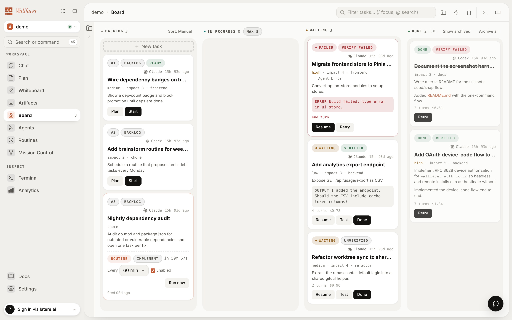
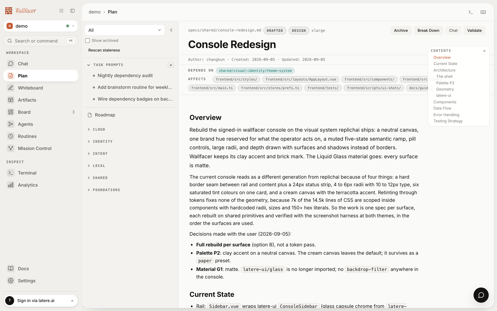
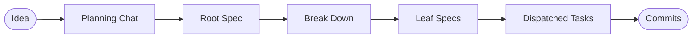
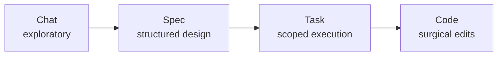
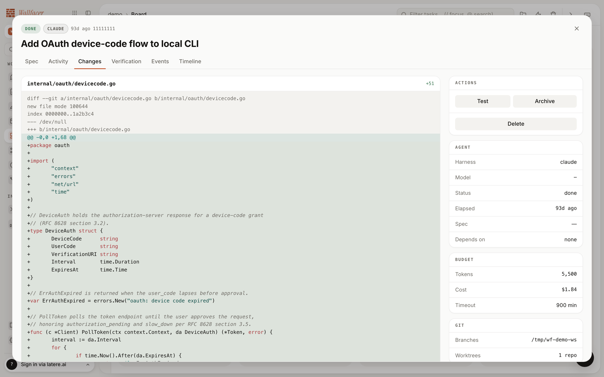

# Wallfacer

**Full autonomy when you trust it. Full control when you don't.**

[](https://github.com/changkun/wallfacer/actions/workflows/test.yml)
[](https://go.dev/)
[](https://github.com/changkun/wallfacer/releases)
[](./LICENSE)
[](https://app.codecov.io/gh/changkun/wallfacer)
[](https://github.com/changkun/wallfacer/stargazers)
[](https://github.com/changkun/wallfacer/commits/main)

Wallfacer is an autonomous engineering platform that works across multiple levels of abstraction. Start with a conversation when you're exploring an idea. Move to specs when the shape becomes clear. Track tasks when it's time to execute. Drop into code when you need precision. Agents operate at every level, and you decide how much freedom they get.

Open source. Runs locally. No IDE lock-in. No cloud dependency. Bring your own LLM provider.

|  |
|:--:|
| *Task board: coordinate parallel agent execution* |

|  |
|:--:|
| *Plan mode: design before you build* |

## Why Wallfacer

Every AI coding tool today pins you to one interaction mode. Chat-based tools are fast but lose structure at scale. Spec-driven tools add discipline but slow you down on day one. Task boards help you coordinate but don't understand your architecture. Wallfacer connects all of these into a continuous workflow.

**Adaptive abstraction.** Chat for greenfield exploration, specs for complex systems (a recursive tree of markdown specs that agents read, iterate on, break down, and dispatch as tasks), tasks for parallel execution, code for surgical edits. Move between levels as your project evolves.

**Autonomy spectrum.** Run the full loop autonomously (implement, test, commit, push) or step in at any point. Dial autonomy up or down per task, per spec, per project.

**Spec as intermediate representation.** Ideas don't go straight to code. They become structured specs that agents can reason about, iterate on, and implement against. Specs are versioned and reviewable.

**Per-task git worktrees.** Each task works in its own git worktree for safe parallel execution. Multiple agents work simultaneously without stepping on each other.

**Operator visibility.** Live logs, traces, timelines, diff review, and usage and cost tracking. A full audit trail from idea to merged code.

**Self-development.** Wallfacer builds Wallfacer. Most recent capabilities were developed by the system itself.

**Harness flexibility.** Works with Claude Code, Codex, Cursor, OpenCode, and Pi through a pluggable harness layer. Pick one per task or per agent role; not locked to any single provider.

## Quick Start

Install:

```bash
curl -fsSL https://raw.githubusercontent.com/changkun/wallfacer/main/install.sh | sh
```

Check prerequisites:

```bash
wallfacer doctor
```

Start the server:

```bash
wallfacer run                    # execs your chosen harness CLI directly as a host process
```

A browser window opens automatically and asks for the project folder; each workspace is one folder. Add your Claude credential (OAuth token via `claude setup-token`, or API key from [console.anthropic.com](https://console.anthropic.com/)) in **Settings**. See [Getting Started](docs/guide/getting-started.md) for the full walkthrough.

Other commands: `wallfacer status` (print or watch board state) and `wallfacer spec` (validate or scaffold specs). Run `wallfacer <command> -help` for flags.

## How It Works

1. **Explore.** Describe what you want to build in chat. Wallfacer helps you shape the idea.
2. **Specify.** The idea becomes a structured spec. Iterate on it until the design is right.
3. **Execute.** Specs break into tasks on a board. Agents implement, test, and commit in isolated git worktrees.
4. **Ship.** Marking reviewed work done rebases it onto the default branch and merges it.



## The Autonomy Spectrum

Wallfacer lets you work at whichever abstraction level fits the problem, and move between them as the shape becomes clearer.



Move left for more freedom and lower commitment; move right for more precision and higher commitment. Agents operate at every level. Specs move through a seven-state lifecycle (`vague` to `drafted` to `validated` to `testing` to `complete`, with `stale` and `archived` off to the side), and the planning chat exposes slash commands like `/create`, `/validate`, `/break-down`, and `/dispatch` to drive them.

Read more: [Concepts](docs/guide/concepts.md) and [Plan](docs/guide/plan.md).

## How execution is structured

Wallfacer runs every task through one built-in pipeline:

- **Tasks** run implementation turns in their own git worktree, then a commit message and an oversight summary. A task's title is the first line of its prompt. A task's instructions come from the repository's instruction files (AGENTS.md, CLAUDE.md) and its prompt.
- **Agent roles** carry the pipeline: impl, test, commit-msg, title, and oversight. Each runs on the task's harness (Claude, Codex, Cursor, OpenCode, or Pi), and a per-role setting can route one role to a different harness.

Task prompts are refined in place from Plan mode.

Read more: [Concepts](docs/guide/concepts.md) and [Configuration](docs/guide/configuration.md).

## Product Tour

### Task board: managed execution

The board (shown above) coordinates many agent tasks at once. Drag cards across the lifecycle, refine prompts before execution, and start tasks up to the parallel limit. Each task runs as a host process in its own git worktree.

### Plan mode: structured design

Design before you build (shown above). The three-pane plan view gives you an explorer tree (left), a focused markdown view (center), and the planning chat (right). Break large ideas into structured specs, validate dependencies, and dispatch leaf specs to the board when the design is right.

### Oversight: an actionable audit trail



Inspect what happened, when, and why before you accept any agent output. Every task produces a structured event timeline, a diff against the default branch, and an AI-generated oversight summary.

### Cost and usage visibility

Each task records token usage and cost per turn and per activity (implementation, testing, oversight), shown in its detail view, so you can see where budget goes.

## Capability Stack

- **Chat.** Planning chat with slash commands and file-explorer context, conversational drift away from or back into specs.
- **Spec.** Seven-state lifecycle, dependency DAG, recursive progress tracking, impact analysis, atomic dispatch and undo.
- **Task.** Host-process execution, per-task git worktrees, cost and token budgets, oversight summaries.
- **Code.** File explorer with editor, live logs and diff review, per-turn usage and timeline, native per-repo AGENTS.md/CLAUDE.md discovery.

## Roadmap

Wallfacer is a local tool: a task board on one machine over the coding-agent CLIs installed there. The current program is a cleanup that keeps that shape and removes what it no longer needs ([`specs/shared/pure-local.md`](specs/shared/pure-local.md)). See [`specs/README.md`](specs/README.md) for the full spec index.

**Foundations** (complete): Execution backend interface, storage backend interface, file explorer, workspace switching, Windows support.

**Local Product**: Developer workflow. Spec coordination (document model, planning UX, drift detection) is complete. Designed and unbuilt: file and image attachments on task prompts, host path references, scoped slash commands, a terminal UI, internal consolidation, and task revert.

**Shared Design** (complete): Agent and harness abstraction, host execution, the agent-session vocabulary, the visual identity and the console redesign.

## Documentation

**[User Manual](docs/guide/usage.md)** is the full reading order. Guides are grouped by what you are doing.

**Get Started**

| Guide | Topics |
|-------|--------|
| [Getting Started](docs/guide/getting-started.md) | Installation, credentials, first task |
| [Concepts](docs/guide/concepts.md) | Mental model: workspaces, tasks, specs, agents, autonomy |

**Use Wallfacer**

| Guide | Topics |
|-------|--------|
| [Board](docs/guide/board.md) | Task board, lifecycle, search, task detail |
| [Plan](docs/guide/plan.md) | Spec mode, lifecycle states, dispatch, planning chat |

**Operate**

| Guide | Topics |
|-------|--------|
| [Oversight](docs/guide/oversight.md) | Oversight summaries, timelines, logs, diff review, usage |
| [Workspaces](docs/guide/workspaces.md) | Workspace management, git integration, branches |
| [Configuration](docs/guide/configuration.md) | Settings, env vars, harnesses, CLI |

**Build On (Internals)** is the deep reference for how the system works. Start at **[Technical Internals](docs/internals/internals.md)**.

| Reference | Topics |
|-----------|--------|
| [Architecture](docs/internals/architecture.md) | System design, package map, handler organization, end-to-end walkthrough |
| [Data & Storage](docs/internals/data-and-storage.md) | Data models, persistence, event sourcing, spec document model |
| [Task Lifecycle](docs/internals/task-lifecycle.md) | State machine, turn loop, failure categorization |
| [Git Operations](docs/internals/git-worktrees.md) | Worktree lifecycle, commit pipeline, branch management |
| [API & Transport](docs/internals/api-and-transport.md) | HTTP route reference, SSE, middleware |
| [Background Work](docs/internals/background-work.md) | Goroutine model, startup recovery, worktree maintenance, oversight generation |
| [Plan Mode](docs/internals/plan-mode.md) | Spec tree, agent sessions, slash commands, dispatch, undo |
| [Workspaces & Config](docs/internals/workspaces-and-config.md) | Workspace manager, harness routing, templates, env config |
| [Development Setup](docs/internals/development.md) | Building, testing, make targets, release workflow |

Contributing? See **[CONTRIBUTING.md](CONTRIBUTING.md)** for the developer orientation, build commands, and conventions.

## Origin

Wallfacer started as a task board for coordinating concurrent agent runs and grew from there: spec coordination, oversight, refinement, an integrated IDE. Most recent capabilities were developed by Wallfacer itself. See [docs/origin.md](docs/origin.md) for the long version.

## Status

Wallfacer is pre-1.0 and released from `main` as tagged versions. The HTTP API
(documented in [API & Transport](docs/internals/api-and-transport.md)), the
on-disk layout under `~/.wallfacer/`, and the `WALLFACER_*` environment
variables can still change between releases. Per-release changes are recorded
in [CHANGELOG.md](CHANGELOG.md). The command surface is `wallfacer run`,
`status`, `spec`, and `doctor`. Every Go package lives under
`internal/`, so this repository exposes no importable public Go API.

## License

[MIT](LICENSE)
