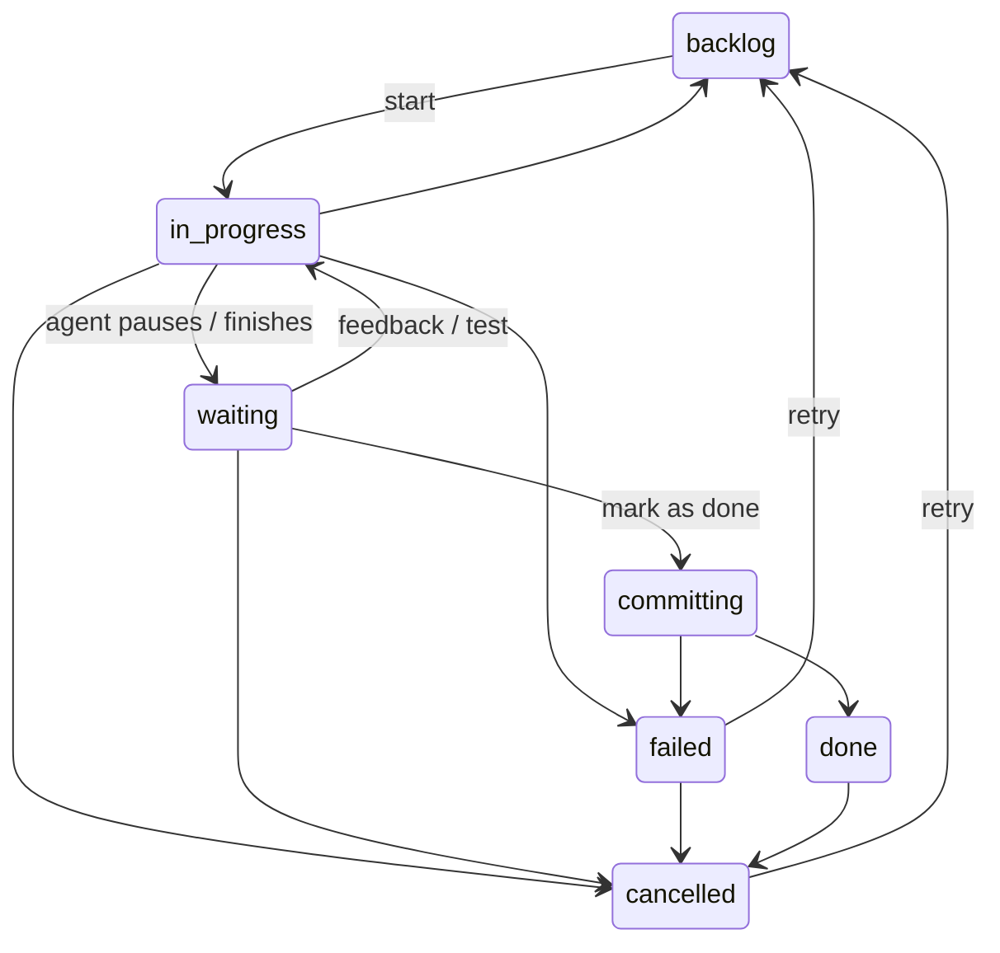
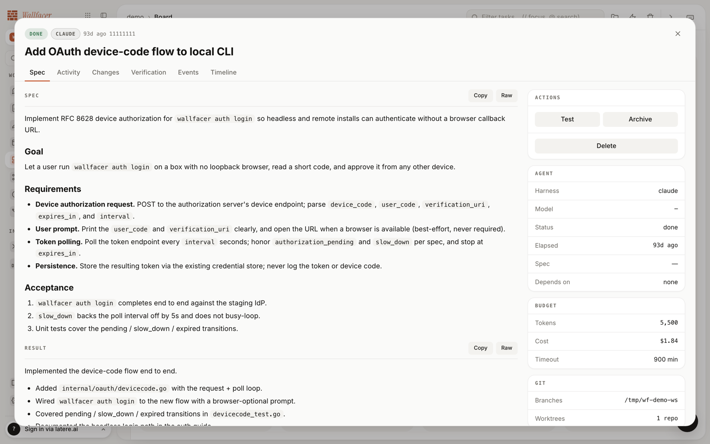

# Board

The Board is the execution surface of wallfacer: a four-column kanban where tasks are created, run by coding agents, reviewed, and merged. Each running task executes as a host process inside its own git worktree, so an agent works on an isolated copy of the code without touching the default branch. For the mental model behind tasks, specs, and agents, see [Concepts](concepts.md); for first-run setup, see [Getting Started](getting-started.md).

## Columns

| Column | Statuses shown | Meaning |
|---|---|---|
| **Backlog** | `backlog` | Queued tasks. Prompt and settings are editable here. |
| **In Progress** | `in_progress`, `committing` | An agent is running in the task's worktree, or the commit pipeline is merging its result. |
| **Waiting** | `waiting`, `failed` | The agent paused for input or a budget raise; failed tasks land here for retry. |
| **Done** | `done`, `cancelled` | Terminal states. Done tasks have their changes merged; cancelled tasks keep their history. |

The In Progress column header shows a `max N` tag: the effective parallel-execution cap for the active workspace. The value resolves from the workspace's `max_parallel` override, then `WALLFACER_MAX_PARALLEL`, with a default of 5 (`0` renders as unlimited). Starting a task while the cap is reached is refused until a running task finishes; see [Workspaces](workspaces.md).

The Done column header carries two controls: **Archive all** archives every done task at once, and **Show archived** reveals archived tasks, which are hidden by default.

## Task lifecycle

Tasks move through seven states. Only the transitions below are legal; the server rejects everything else.

| From | To |
|---|---|
| `backlog` | `in_progress` |
| `in_progress` | `backlog`, `waiting`, `failed`, `cancelled` |
| `waiting` | `in_progress`, `committing`, `cancelled` |
| `committing` | `done`, `failed` |
| `failed` | `backlog`, `cancelled` |
| `done` | `cancelled` |
| `cancelled` | `backlog` |

Note that `in_progress` never jumps straight to `committing` or `done`: completion always passes through `waiting`, where the result is reviewed, optionally tested, and either accepted or sent back with feedback. **Mark as Done** moves a waiting task into `committing`, which rebases the task branch onto the default branch, fast-forward merges it, and cleans up the worktree. Details in [Task Lifecycle internals](../internals/task-lifecycle.md) and [Git Worktrees](../internals/git-worktrees.md).

### Failure categories

Every failed task carries a failure category, shown on the card:

| Category | Meaning |
|---|---|
| `container_crash` | The agent process exited unexpectedly (the name predates host-process execution) |
| `sync_error` | A rebase or merge failed during sync |
| `worktree_setup` | Worktree creation failed |
| `timeout` | The task exceeded its time limit |
| `budget_exceeded` | The token or cost budget ran out |
| `agent_error` | The agent itself reported failure |
| `unknown` | Unclassified |

Recurring `container_crash` failures point to a CLI or credential problem, which `wallfacer doctor` checks. `agent_error` and `timeout` call for a clearer prompt, a smaller scope, or feedback on the task. `sync_error` and `worktree_setup` failures often clear on **Retry** once the repository is back in a clean state.

## Creating tasks

Click **+ New Task** in the Backlog header. The composer offers:

- **Prompt**: the work description, with Markdown support and `@` file mentions. The draft auto-saves to local storage, so navigating away loses nothing.
- **Tags**: press Enter or comma to add a label. Tags are lowercase; `priority:N` and `impact:N` get special card styling.
- **Timeout**: 15 min, 30 min, 1 hour, 2 hours, 5 hours, or a custom value. The default is no timeout.
- **More** expands: a model override, budget limits (max cost in USD and max input tokens), and a harness override.

Every task carries a short **Title** and the full **Prompt**. The title is the first non-blank line of the prompt, with a leading Markdown heading marker removed and shortened at a word boundary when it runs long.

## Starting, resuming, and completing

A task starts when it moves from Backlog to In Progress: drag the card or click **Start task** in the detail view. The server creates a branch `task/<uuid-prefix>` and a worktree per workspace folder, launches the selected harness as a host process, and streams live output into the detail view. Each prompt/response round-trip is a turn; token usage and cost accumulate per turn.

When the agent pauses or finishes, the task lands in **Waiting**. From there:

| Action | Effect |
|---|---|
| **Submit feedback** | Send a message (with `@` file mentions); the agent resumes in the same session. |
| **Mark as Done** | Trigger the commit pipeline and merge the changes. |
| **Sync** | Rebase the task's worktree onto the latest default branch without merging. |
| **Raise budget** | Shown when a cost or token limit was hit; adjust the limit and continue. |
| **Cancel** | Discard the worktree and move to Cancelled; history and logs are preserved. |

Failed tasks offer **Resume** (continue the existing agent session with an extended timeout, available when a session exists), **Retry** (back to Backlog, optionally with an edited prompt and a fresh or resumed session), and **Sync**. Done tasks can be archived; cancelled tasks can be retried.

Full per-state action availability in the detail view:

| Status | Actions |
|---|---|
| `backlog` | Start task, Edit task, Delete |
| `in_progress` / `committing` | Cancel, Delete |
| `waiting` | Mark as Done, Raise budget (when budget-hit), Sync, Cancel, Delete |
| `failed` | Resume (with session), Raise budget, Sync, Retry, Delete |
| `done` | Archive, Delete |
| `cancelled` | Retry, Archive, Delete |
| archived | Unarchive, Delete |

## Search and filtering

The header search bar filters visible cards live by title, prompt, and tags. Use `#tagname` to filter by tag. Escape clears it. Prefixing a query with `@` hands it to the command palette's server-side search, which covers all tasks (including archived) by title, prompt, tags, and oversight summaries.

## Command palette

Click **Search or command** at the top of the sidebar to open the palette. It combines fuzzy local task search, server-side task search, and spec matches from the Plan tree. When a task is highlighted, state-dependent actions appear:

- Backlog: **Plan** (open task-mode chat in Plan), **Start**
- Waiting: **Resume** (with session), **Done**, **Sync**
- Failed: **Resume** (with session), **Retry**, **Sync**
- Done / Cancelled: **Retry**
- Any non-backlog task: **Open changes**; once at least one turn has run, **Open timeline**

## Task detail view

Click any card to open the detail view. A left rail carries the header (status, tags, elapsed time, cost, short ID), settings, and the action buttons; the main pane switches between five tabs.

| Tab | Content |
|---|---|
| **Spec** | The prompt and latest result as rendered Markdown (raw toggle, copy) and, for waiting tasks, the inline feedback box. |
| **Activity** | Oversight summaries per phase followed by the parsed agent transcript (thinking, tool calls, results) with a filter box; raw output fallback. |
| **Changes** | Task commits with expandable patches, followed by the aggregate diff and a commits-behind warning. |
| **Events** | The event audit trail grouped by type, usage statistics, per-agent usage, retry history, and prompt history. |
| **Timeline** | Execution spans rendered as a flamegraph with a time axis, an optional cumulative-cost overlay, and a span table sorted by duration. |

### Commit history

The **Task commits** list records commits across feedback turns and retries.
Each entry shows its repository, hash, subject, author, date, execution attempt,
and first observed turn. Expand an entry to read its patch. The list refreshes
while the Changes tab is open and remains available after worktree cleanup or
an agent amends a previously recorded commit.

Uncommitted edits remain in the aggregate diff below the list. Existing tasks
whose worktrees were removed before commit-history capture was introduced can
have no recorded entries. Patch previews are limited to 2 MiB per commit, with
an explicit notice when truncated. A history-storage failure keeps the worktree
and marks the task failed so it can be retried after storage is repaired.

### Inline diff comments

While a task is waiting, each line in the **Changes** tab gets a gutter button that opens an inline comment box. Comments collect in a **Review comments** panel grouped by file, alongside a general feedback box. **Submit** batches every line comment plus the general text into a single feedback message, and the agent resumes with the full review as its next input.

### Timeline

The **Timeline** tab renders every recorded span (worktree setup, agent turns, commits) as a Gantt-style flamegraph with idle time compressed, plus a detail table.

## Backlog sort

The Backlog header toggles between two sort modes: **Manual** (drag to reorder; cards show their rank) and **Impact** (descending impact score; dragging is disabled). The choice persists per browser.

## Archive and trash

Archiving hides a done or cancelled task from the Done column while keeping its full history; **Archive all** in the Done header archives every done task at once, and **Show archived** reveals them again. Unarchive restores a task to the column.

Deleting a task is a soft delete: the task becomes a tombstone recoverable for 7 days (configurable via `WALLFACER_TOMBSTONE_RETENTION_DAYS`), after which it is purged on server startup. The trash icon in the board header opens the Trash modal, which lists deleted tasks with their remaining retention and a **Restore** button.

## See also

- [Plan](plan.md): author and dispatch specs that become board tasks
- [Oversight](oversight.md): summaries, usage, cost, and timing
- [Workspaces](workspaces.md): folders, worktrees, and per-workspace settings
- [Configuration](configuration.md): environment variables and settings tabs
- [API & Transport internals](../internals/api-and-transport.md): the HTTP API behind every board action
