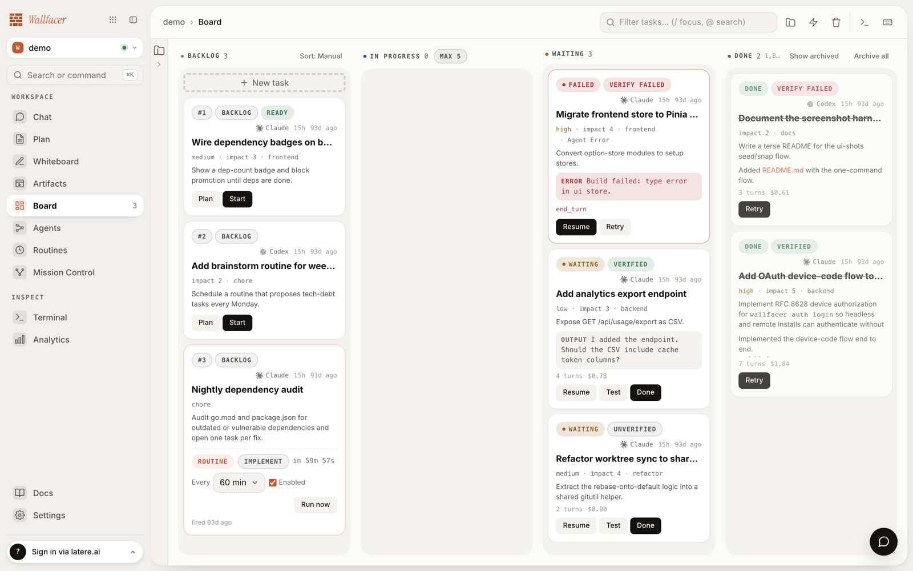

# Getting Started

Wallfacer is a single binary that runs a local task board for coding agents. Tasks execute in isolated git worktrees on the host machine, and results wait for review before anything lands. This guide covers installation, credentials, the first run, and a first task end to end.

## Install

The quickest path is the installer script, which detects the OS and architecture and downloads the latest release binary:

```bash
curl -fsSL https://raw.githubusercontent.com/changkun/wallfacer/main/install.sh | sh
```

Set `WALLFACER_INSTALL_DIR` to choose the install location (default: `/usr/local/bin`, falling back to `~/.local/bin`), or `WALLFACER_VERSION` to pin a specific release.

Alternatively, download a binary directly from the [releases page](https://github.com/changkun/wallfacer/releases). Wallfacer is a single self-contained executable: the web UI and documentation are embedded, and no container runtime or database is required.

Prerequisites:

- The `claude` CLI on `PATH` (`npm i -g @anthropic-ai/claude-code`). The server refuses to start without it.
- Git, recommended. Non-git folders work as workspaces, but git features (worktree isolation, diffs, push) are unavailable there.
- Optional harness CLIs for non-Claude tasks: `codex`, `cursor-agent`, `opencode`, `pi`. See [Configuration](configuration.md#harness-tab) for their setup.

## Check the setup

Run the doctor command to verify prerequisites:

```bash
wallfacer doctor
```

The doctor prints the config paths, checks that `~/.wallfacer/.env` exists, verifies the Claude credential, probes the `claude` binary (and the optional `codex` and `cursor-agent` binaries) with a version call, and checks for git. Lines marked `[ok]` pass, `[!]` need attention, and `[ ]` are optional items that are not configured. Credential values are masked in the output. `wallfacer env` is an alias for the same check.

## Credentials

Wallfacer reads credentials from `~/.wallfacer/.env`. The file is created with a commented template on the first run; edit it directly or use **Settings > Harness** in the UI.

Claude tasks run on the sign-in of the `claude` CLI on the machine. To run them on another account or on an API key instead, set one of:

- `CLAUDE_CODE_OAUTH_TOKEN`: an OAuth token from `claude setup-token` (Claude Pro/Max subscription). Takes precedence when both are set.
- `ANTHROPIC_API_KEY`: an API key from console.anthropic.com.

Credentials for the other harnesses are optional and only needed when tasks are routed to them: `OPENAI_API_KEY` for Codex, `CURSOR_API_KEY` for Cursor, `opencode auth login` for OpenCode, and Pi reads provider keys from the same environment. The full reference is in [Configuration](configuration.md#environment-variables).

## First run

```bash
wallfacer run
```

On startup the server checks that the `claude` binary resolves and exits with an install hint if it does not. It then creates `~/.wallfacer/` on first use, seeds the `.env` template, and opens the browser at `http://localhost:8080`. Pass `-no-browser` to skip the browser, or `-addr :9090` to change the port.

Pages that need a workspace show a folder picker on first visit. Pick one or more project folders; the selection becomes a named workspace that persists across restarts. See [Workspaces](workspaces.md) for grouping folders and switching between workspaces.



## First task, end to end

The board has four columns: Backlog, In Progress, Waiting, and Done.

1. Click the composer and describe the change in plain language, then save it. The card lands in Backlog.
2. Click **Start** on the card. The task moves to In Progress: a dedicated git worktree is created on branch `task/<id>`, and the implementation agent runs there.
3. Open the card to watch live log output stream into the task detail timeline while the agent works.
4. When the agent finishes, the card moves to Waiting. Open the **Changes** tab to review the diff. Leave comments directly on diff lines to send feedback; the task resumes with the comments as instructions.
5. Accept the work by clicking **Done** (or pressing `d` on the focused card). The task passes through a brief committing phase where the commit message agent writes the commit, then lands in Done.

Failed tasks carry a failure category and can be retried or sent back to Backlog. The [Board](board.md) guide covers verification and feedback in depth.

## Where data lives

Everything is stored under `~/.wallfacer/`:

| Path | Contents |
|---|---|
| `.env` | Credentials and runtime settings |
| `data/` | Task board state and events |
| `workspaces.json` | Workspace definitions |
| `worktrees/` | Per-task git worktrees |
| `agent-sessions/` | Chat and plan session history |
| `tmp/` | Scratch space |

## Next steps

- [Concepts](concepts.md): the mental model, from chat to full automation
- [Board](board.md): task lifecycle, review, and feedback in detail
- [Configuration](configuration.md): settings, CLI reference, and environment variables
