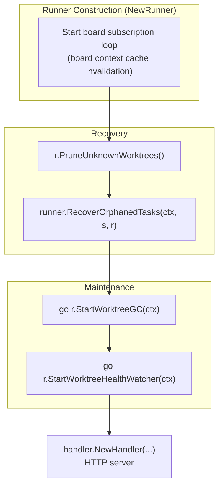
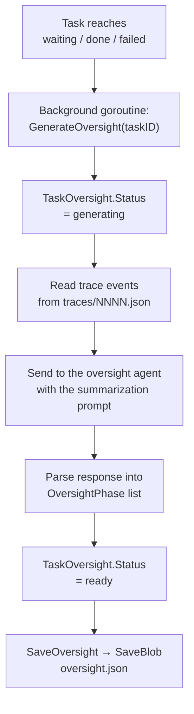

# Background Work and Recovery

Wallfacer has no scheduler and no automation loop. A task runs because a request started it: a start, feedback, a test, a sync, or Mark as Done. What runs in the background is the work those requests start, two worktree maintenance goroutines, oversight generation, and the recovery pass at startup.

## Background Goroutine Model

No message queue, no worker pool. Concurrency is plain Go goroutines:

```go
// Task execution (new or resumed)
go h.runner.Run(id, prompt, sessionID, freshStart)

// Post-feedback resumption
go h.runner.Run(id, feedbackMessage, sessionID, false)

// Commit pipeline after mark-done
go func() {
    h.runner.Commit(id)
    store.UpdateStatus(id, "done")
}()
```

Tasks are long-running and IO-bound (host-process agent runs, git operations), so goroutines are appropriate: no CPU contention, and Go's scheduler handles the rest.

Every start, feedback, resume, test, sync, and done request takes `transitionMu` (`internal/handler/tasks_concurrency.go`) around its status check and status write, so two requests cannot both act on one task. A manual start from `backlog` also checks the parallel limit under the same lock: the workspace's `MaxParallel` override when set, otherwise `WALLFACER_MAX_PARALLEL`. A start over the limit is refused with `409 Conflict`.

## Startup Sequence

`RunServer` (`internal/cli/server.go`) constructs the `Runner`, runs the recovery pass, starts the maintenance goroutines, and only then builds the `Handler` and serves HTTP:



### Recovery Scans

Both recovery operations run synchronously before the server accepts requests:

- **`PruneUnknownWorktrees()`**: Scans the `worktrees/` directory and removes any worktree directories that do not correspond to a known task. Also runs `git worktree prune` on each workspace repository to clean up stale Git worktree references.
- **`RecoverOrphanedTasks()`**: Reconciles tasks left in `in_progress` or `committing` after a server restart, then removes worktree directories whose tasks have reached a terminal state or no longer exist (`ScanOrphanedWorktrees`, `PruneOrphanedWorktrees`).

### RecoverOrphanedTasks

`RecoverOrphanedTasks` in `runner/recovery.go` does not look for agent processes left over from the previous server. It decides from the stored status and the worktrees on disk:

| Status at restart | Outcome |
|---|---|
| `committing` | Inspect each worktree's branch tip. If a commit landed after the task's `UpdatedAt`, the commit pipeline finished just before the crash, so promote to `done`. Otherwise mark `failed`. |
| `in_progress`, worktrees present | Move to `waiting` with a system event, so the user can review the partial output and decide whether to continue or mark the task done. |
| `in_progress`, a worktree missing | Mark `failed` with `FailureCategory = worktree_setup`. |

Every transition uses `ForceUpdateTaskStatus`, since a crash can leave a task in a state the normal transition table does not cover, and records a `state_change` event with the `recovery` trigger. See [Task Lifecycle](task-lifecycle.md#crash-recovery) for why a stopped task goes to `waiting` rather than `failed`.

### Worktree Maintenance

`StartWorktreeGC` removes worktrees of finished tasks on `WALLFACER_WORKTREE_GC_INTERVAL` (24 hours by default). `StartWorktreeHealthWatcher` checks every two minutes for active tasks whose worktree directory went missing and recreates it. Both are described in [Git Worktrees](git-worktrees.md#worktree-garbage-collection).

## Oversight Generation

Oversight is generated asynchronously whenever a task transitions to `waiting`, `done`, or `failed`. It is also regenerated periodically during execution if `WALLFACER_OVERSIGHT_INTERVAL > 0` (minutes).



Served by:
- `GET /api/tasks/{id}/oversight`, implementation run summary

The UI renders phases in the Oversight tab and as an interactive flamegraph Timeline.

The generator reads the task's trace events, passes them to the oversight agent with a summarization prompt, and writes the result as a `TaskOversight` (`status`: `pending` → `generating` → `ready` | `failed`). `SaveOversight` persists it as a single blob via `SaveBlob`: the summary lands in `oversight.json` directly under the task directory (`data/<uuid>/`), matching [Data & Storage](data-and-storage.md).

`POST /api/tasks/generate-oversight` generates oversight for tasks that are missing a summary, such as tasks that finished before the feature existed.

## Records from Removed Features

Records that carry `Kind = "idea-agent"` or `FlowID = "brainstorm"` load as ordinary tasks; dispatch does not read `FlowID`. Routine cards (`Kind = "routine"`) are skipped at load: their files stay on disk, unread and unrewritten, and the store logs one warning with their count.

Task and workspace records written while automation and review existed load without migration. The decoder ignores their extra fields (`scheduled_at`, `auto_retry_budget`, `auto_retry_count`, `test_fail_count`, `pending_test_feedback`, `last_fetch_error`, the `review_*` fields, and the per-workspace `autoimplement`, `autotest`, `autosubmit`, `autosync`, and `max_test_parallel` keys), and the next save writes the record without them. State-change events keep the trigger they were recorded with, so an older timeline can still show `auto_promote`, `auto_retry`, `auto_test`, `auto_submit`, `auto_review`, or `sync`.

Task records written while task dependencies, generated titles, the manual test run, and acceptance criteria existed load the same way. The decoder ignores `depends_on`, `title_generating`, `is_test_run`, `last_test_result`, `test_run_start_turn`, `custom_pass_patterns`, `custom_fail_patterns`, and `criteria`, and the next save writes the record without them. A stored `sandbox_by_activity` entry for `testing` or `title` is dropped on load, and the env-file keys `CLAUDE_TITLE_MODEL`, `CODEX_TITLE_MODEL`, `WALLFACER_SANDBOX_TITLE`, `WALLFACER_SANDBOX_TESTING`, and `WALLFACER_MAX_TEST_PARALLEL` are ignored. Titles stored by earlier releases are kept as they are.

## See Also

- [Task Lifecycle](task-lifecycle.md), state machine, turn loop, crash recovery
- [Git Worktrees](git-worktrees.md), worktree isolation, the commit pipeline, conflict resolution, GC and health watcher
- [API & Transport](api-and-transport.md), HTTP API, SSE streams, graceful shutdown
- [Architecture](architecture.md), high-level design decisions and persistence model
