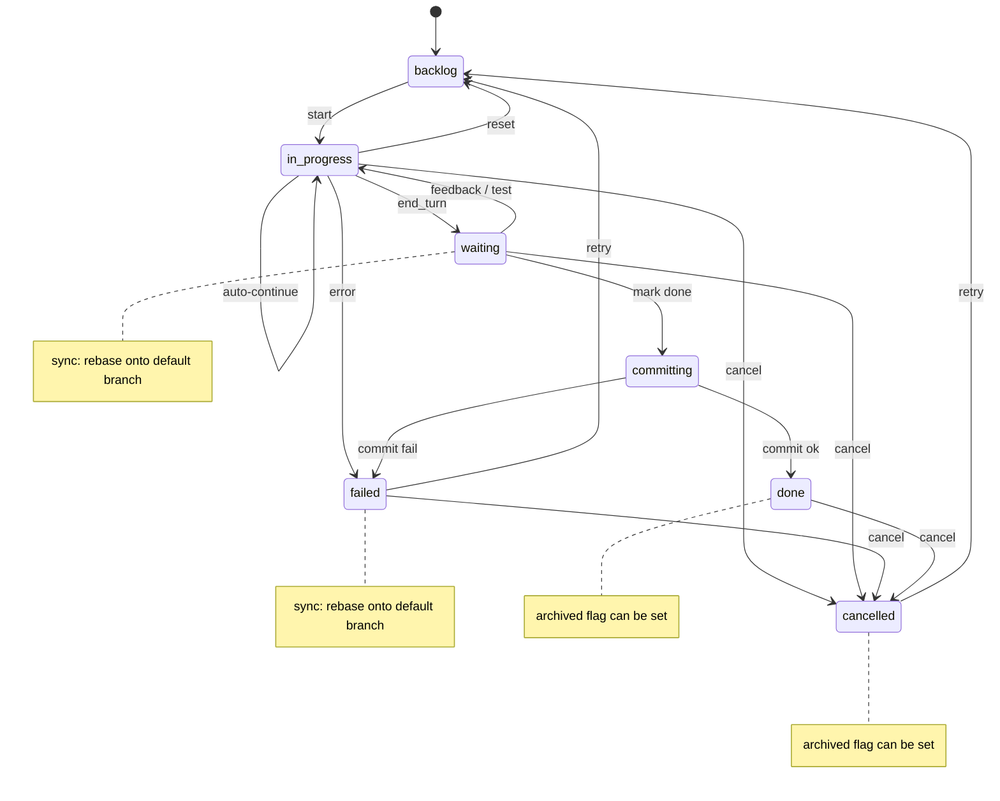

# Task Lifecycle

## State Machine

Tasks progress through a well-defined set of states. Every transition is recorded as an immutable event in `data/<uuid>/traces/`.



Transition labels are shortened for legibility. In full:

| Transition | Trigger |
|---|---|
| `backlog` to `in_progress` | User drag or **Start task**, refused with 409 at the parallel limit |
| `in_progress` to `in_progress` | `stop_reason` of `max_tokens` or `pause_turn`, auto-continued in the same session |
| `in_progress` to `waiting` | `stop_reason` of `end_turn`, or an empty/unknown `stop_reason` |
| `in_progress` to `failed` | Process error, agent error, timeout, or a budget limit exceeded |
| `waiting` to `in_progress` | User feedback, or a test run (`IsTestRun`) |
| `committing` to `done` / `failed` | Commit pipeline success or failure |
| `failed` to `backlog` | Retry |

## States

| State | Description |
|---|---|
| `backlog` | Queued, not yet started |
| `in_progress` | Host process running, agent executing |
| `waiting` | Claude paused mid-task, awaiting user feedback |
| `committing` | Transient: commit pipeline running after mark-done |
| `done` | Completed; changes committed and merged |
| `failed` | Process error, Claude error, timeout, or budget exceeded |
| `cancelled` | Explicitly cancelled; worktree cleaned up, history preserved |

**Note:** `archived` is a boolean flag (`Archived bool`) on the task, not a separate state. Tasks in `done` or `cancelled` state can have `Archived = true`, which moves them to the Archived column in the UI. The state machine has exactly 7 states (`backlog`, `in_progress`, `waiting`, `committing`, `done`, `failed`, `cancelled`).

## Turn Loop

Each pass through the loop in `runner.go` `Run()`:

1. Increment turn counter
2. Exec the selected CLI as a host process with the current prompt and session ID, using the task's git worktree as CWD
3. Save raw stdout to `data/<uuid>/outputs/turn-NNNN.json`; stderr (if any) to `turn-NNNN.stderr.txt`
4. Parse `stop_reason` from agent JSON output:

| `stop_reason` | `is_error` | Result |
|---|---|---|
| `end_turn` | false | Exit loop → `waiting` (awaiting review; the user marks done to trigger the commit pipeline) |
| `max_tokens` | false | Auto-continue (next iteration, same session) |
| `pause_turn` | false | Auto-continue (next iteration, same session) |
| empty / unknown | false | Set `waiting`; block until user provides feedback |
| any | true | Set `failed` with classified `FailureCategory` |

5. Accumulate token usage (`input_tokens`, `output_tokens`, cache tokens, `cost_usd`)
6. Record per-turn usage as `TurnUsageRecord`

The CWD comes from the task's worktree map (`agentWorkDir`, `internal/runner/container.go`): the worktree for the workspace folder when the task has one, else the first worktree in sorted folder order, and the live workspace folder only when the task has no worktree. A task created in one folder and resumed after the workspace was re-pointed therefore keeps working in its own worktree. A task stored with worktrees in several folders (from before a workspace became one folder) runs the same way; before its first turn `noteSeveralWorktrees` writes one system event on its timeline naming the folder the agent works in, and the commit pipeline still visits every folder's worktree.
7. Check budget limits (`MaxCostUSD`, `MaxInputTokens`); if exceeded → `failed` with `FailureCategory = budget_exceeded`

## Session Continuity

Claude Code supports `--resume <session-id>` for session continuity. The first turn creates a new session; subsequent turns (auto-continue or post-feedback) pass the same session ID, preserving the full conversation context.

Setting `FreshStart = true` on a task skips `--resume`, starting a brand-new session. This is what happens when a user retries a failed task.

## Feedback & Waiting State

When `stop_reason` is empty, Claude has asked a question or is blocked. The task enters `waiting`:

- Worktrees are **not** cleaned up, the git branch is preserved
- User submits feedback via `POST /api/tasks/{id}/feedback`
- Handler writes a `feedback` event to the trace log, then launches a new `runner.Run` goroutine using the existing session ID
- The task resumes from exactly where it paused, with the feedback message as the next prompt

Alternatively, the user can mark the task done from `waiting`, which skips further Claude turns and jumps straight to the commit pipeline.

## Cancellation

Any task in `backlog`, `in_progress`, `waiting`, or `failed` can be cancelled via `PATCH /api/tasks/{id}` with `{"status": "cancelled"}`. The handler:

1. **Kills the host process** (if `in_progress`). Sends `SIGTERM`, escalating to `SIGKILL` after 5 s if the process is still running (`internal/executor/host.go`). The running goroutine detects the cancelled status and exits without overwriting it to `failed`.
2. **Cleans up worktrees**, removes the git worktree and deletes the task branch, discarding all prepared changes.
3. **Sets status to `cancelled`** and appends a `state_change` event.
4. **Preserves history**, `data/<uuid>/traces/` and `data/<uuid>/outputs/` are left intact so execution logs, token usage, and the event timeline remain visible.

From `cancelled`, the user can retry the task (moves it back to `backlog`) to restart from scratch.

## Failure Categorization

When a task transitions to `failed`, the runner classifies the failure into one of these categories:

| Category | Description |
|---|---|
| `timeout` | Per-turn timeout exceeded |
| `budget_exceeded` | Cost or token budget limit reached |
| `worktree_setup` | Git worktree creation failed |
| `container_crash` | Host process exited unexpectedly (legacy category name) |
| `agent_error` | Agent reported an error in its output |
| `sync_error` | Rebase/sync operation failed |
| `unknown` | Unclassifiable failure |

The category is stored in `Task.FailureCategory` and included in `RetryRecord` when the task is reset for retry.

## Retry History

Each time a task is reset for retry, a `RetryRecord` is appended to `Task.RetryHistory`:

```
RetryRecord {
  RetiredAt        time.Time
  Prompt           string
  Status           TaskStatus
  Result           string           // truncated to 2000 chars
  SessionID        string
  Turns            int
  CostUSD          float64
  FailureCategory  FailureCategory
}
```

The list is capped at `DefaultRetryHistoryLimit` (10) entries. This allows operators to inspect the history of failed attempts.

## Title Generation

When a task is created, a background goroutine (`runner.GenerateTitle`) runs a lightweight host process to generate a short title from the prompt. Titles are stored on the task and displayed on the board cards instead of the full prompt text. `POST /api/tasks/generate-titles` can retroactively generate titles for older untitled tasks.

## Prompt Refinement

Prompt refinement is the Plan task-mode chat. There are no dedicated refine routes or background refinement jobs. The agent session converses with the user about the task, and when both agree on an improved prompt the agent calls the `update_task_prompt` tool, which the console forwards as `POST /api/agent/tool/update_task_prompt` (`internal/handler/agentsession_tool.go`). The handler moves the prior prompt into history and sets the task's prompt to the new text. See [Plan Mode](plan-mode.md) for the task-mode chat flow.

## Test Verification

Once a task has reached `waiting` (Claude finished but the user hasn't committed yet), a test verification agent can be triggered to check whether the implementation meets acceptance criteria.

```
POST /api/tasks/{id}/test
  body: { criteria?: string }   // optional additional acceptance criteria
  ↓
  Sets IsTestRun = true, clears LastTestResult.
  Transitions waiting → in_progress.
  Launches a fresh host process (separate session, no --resume) with a test prompt.

Test agent runs (IsTestRun = true):
  Process executes: inspect code, run tests, verify requirements.
  Agent must end its response with **PASS** or **FAIL**.

On end_turn:
  parseTestVerdict() extracts "pass", "fail", or "unknown" from the result.
  Records verdict in LastTestResult.
  Transitions in_progress → waiting (no commit).
  Test output is shown separately from implementation output in the task detail panel.
```

The test verdict is displayed as a badge on the task card and in the task detail panel. Multiple test runs are allowed; each overwrites the previous verdict. The `TestRunStartTurn` field records which turn the test started so the UI can split implementation vs. test output.

After reviewing the verdict, the user can:
- Mark the task done (commit pipeline runs) if the verdict is PASS
- Provide feedback to fix issues, then re-test
- Cancel the task

## Board Context

Before each turn the runner writes a `board.json` manifest of all non-archived tasks to a host directory (the BoardDir) and passes its path to the agent via the `WALLFACER_BOARD_JSON` environment variable (`internal/runner/{container.go,execute.go}` `writeBoardDir`). The current task is marked `"is_self": true`. This gives agents cross-task awareness to avoid conflicting changes with sibling tasks. The manifest is refreshed before every turn. It names no other task's worktree: an agent sees the other tasks' prompts, status and branches, and works only in its own worktree.

## Data Models

See [Data & Storage](data-and-storage.md) for data model definitions.

## Persistence

See [Data & Storage](data-and-storage.md).

## Crash Recovery

On startup, `RecoverOrphanedTasks` in `runner/recovery.go` reconciles tasks that were interrupted by a server restart. It does not look for agent processes from the previous server; it decides from the stored status and the worktrees on disk:

| Previous status | Recovery action |
|---|---|
| `committing` | Inspect each worktree's branch tip: if a commit landed after `UpdatedAt` → `done`; otherwise → `failed` |
| `in_progress` | → `waiting`, so the user can review partial output, provide feedback, or mark the task done |

If a worktree is missing during recovery, the task is marked `failed` with `FailureCategory = worktree_setup`.

**Why `waiting` instead of `failed` for interrupted tasks?**
The task may have produced useful partial output. Moving to `waiting` lets the user inspect results and choose the next action (resume with feedback, mark as done, or cancel) rather than forcing a retry from scratch.

## Oversight Generation

See [Background Work and Recovery](background-work.md#oversight-generation).

## Output Truncation

Server-side output truncation is controlled by `WALLFACER_MAX_TURN_OUTPUT_BYTES` (default 8 MB). When a turn's stdout or stderr exceeds this limit, the output is truncated and a sentinel is appended. Truncated turn numbers are recorded in `Task.TruncatedTurns` so the UI can surface warnings.

---

## Storage Layer Deep-Dive

See [Data & Storage](data-and-storage.md).

## Migration System

See [Data & Storage](data-and-storage.md).

## Search Index

See [Data & Storage](data-and-storage.md).

## Soft Delete Implementation

See [Data & Storage](data-and-storage.md).

---

## Dependency Resolution

Tasks can declare dependencies on other tasks via `DependsOn []string` (a list of task UUID strings). Dependencies are recorded and validated for cycles, and the board shows whether they are met; starting a task does not check them.

### DAG Validation in Batch Create

`POST /api/tasks/batch` (`Handler.BatchCreateTasks` in `internal/handler/tasks.go`) performs comprehensive DAG validation before creating any tasks. The entire validation phase has zero side effects, if any check fails, no tasks are created.

#### Step-by-Step Validation

1. **Ref uniqueness**: Each task in the batch can have a symbolic `ref` string. Duplicate refs are rejected.

2. **Prompt and pattern validation**: Every task must have a non-empty prompt, and every entry of its `custom_pass_patterns` and `custom_fail_patterns` must compile as a regular expression.

3. **Field validation**: The request body is decoded strictly, so an unknown field (including the `flow` field earlier releases accepted) is rejected with a 400. The `sandbox` and `sandbox_by_activity` fields are rejected outright with a 400 that names `PATCH /api/tasks/{id}`, where a task's harness is set after creation.

4. **Dependency reference resolution**: Each `depends_on_refs` entry must be either a known batch ref or a syntactically valid UUID.

5. **Batch-internal cycle detection (Kahn's algorithm)**: The batch-internal dependency edges are extracted into an adjacency list. Kahn's topological sort algorithm processes nodes with in-degree 0 iteratively:

   ```
   inDegree[i] = number of batch tasks that task i depends on
   batchAdj[i] = indices of tasks that depend on task i

   queue = all tasks with inDegree == 0
   while queue is not empty:
       curr = dequeue
       topoOrder.append(curr)
       for each next in batchAdj[curr]:
           inDegree[next]--
           if inDegree[next] == 0: enqueue(next)

   if len(topoOrder) != n: cycle detected
   ```

   When a cycle is detected, the response includes the refs of all tasks involved in the cycle.

6. **UUID pre-assignment**: UUIDs are pre-assigned for all batch tasks so that cross-reference resolution and full-graph cycle detection can reason about the complete post-creation dependency graph.

7. **External dependency existence**: Every UUID-format dependency that is not a batch ref is verified to exist in the store via `GetTask`.

8. **Full combined-graph cycle detection**: A combined adjacency map is built from all existing tasks plus the proposed batch tasks (using pre-assigned UUIDs). For each new task, `taskReachableInAdj` performs a DFS to check whether the task can reach itself through its dependencies:

   ```go
   func taskReachableInAdj(adj map[uuid.UUID][]uuid.UUID, start, target uuid.UUID) bool {
       // DFS from start; returns true if target is reachable
   }
   ```

   This catches cycles that span both existing tasks and new batch tasks.

#### Creation Order

Tasks are created in topological order (from the Kahn's sort output), so each task's dependencies already exist in the store by the time it is created. The response returns tasks in the original input order with a `ref_to_id` mapping.

### Single-Task Dependency Update

`PATCH /api/tasks/{id}` with a `depends_on` field rejects a malformed UUID, a self-dependency, and an unknown task, then runs `taskReachable` over every task (archived included) and answers 400 when a new edge would close a cycle. The list is stored via `UpdateTaskDependsOn`.

---

## Board Context Generation

Board context gives each running agent visibility into sibling tasks on the board, enabling cross-task coordination and conflict avoidance.

### What Board Context Contains

The board context is a `BoardManifest` JSON file written to a host BoardDir and handed to the agent by path via `WALLFACER_BOARD_JSON` (see [Board Context](#board-context) above):

```go
type BoardManifest struct {
    GeneratedAt time.Time   `json:"generated_at"`
    SelfTaskID  string      `json:"self_task_id"`
    Tasks       []BoardTask `json:"tasks"`
}
```

Each `BoardTask` entry includes:

| Field | Description |
|---|---|
| `id` | Full UUID string |
| `short_id` | First 8 characters of the UUID |
| `title` | Task display title |
| `prompt` | Task prompt (truncated to 500 chars for siblings) |
| `status` | Current task status |
| `is_self` | `true` for the task's own entry |
| `turns` | Turn count (0 for siblings to reduce noise) |
| `result` | Last result text (truncated to 1000 chars for siblings) |
| `stop_reason` | Last stop reason |
| `usage` | Token/cost usage |
| `branch_name` | Git branch name |
| `created_at` / `updated_at` | Timestamps |

`SessionID` is deliberately excluded from `BoardTask` to prevent session hijacking between tasks.

### How Board Context Is Assembled

`generateBoardContext` in `internal/runner/board.go` produces the `board.json` bytes:

1. Lists all non-archived tasks via `store.ListTasks`.
2. Builds the set of workspace repo paths the self task operates on (the keys of its worktree map, or the workspace folder when it has no worktree yet).
3. Filters siblings to only those sharing that folder, so tasks from before the workspace was re-pointed drop out.
4. For the self task: includes full `Prompt`, `Result`, and `Turns`.
5. For siblings: truncates `Prompt` to 500 chars, `Result` to 1000 chars, zeros `Turns`.
6. Marshals to JSON with indent; logs a warning if the manifest exceeds 64 KB.

### Caching

Results are cached by `(boardChangeSeq, selfTaskID)`. The cache is invalidated when any store mutation increments the change sequence. Per-turn calls cost nearly nothing when no task has changed since the last generation.

### API Endpoints

- `GET /api/tasks/{id}/board`, Returns the `BoardManifest` as it appears to a specific task (with that task marked `is_self: true`).
- `GET /api/debug/board`, Returns the `BoardManifest` as seen by a hypothetical new task (no task marked as self, `selfTaskID` = `uuid.Nil`).

---

## Task Summaries

See [Data & Storage](data-and-storage.md).

---

## See Also

- [Internals Index](internals.md), Overview and reading order for all internals docs
- [Architecture](architecture.md), System design, component overview, and design decisions
- [Data & Storage](data-and-storage.md), Data models, persistence, storage layer, migrations, search index, soft delete, task summaries
- [Background Work and Recovery](background-work.md), startup recovery, oversight generation
- [Git Worktrees](git-worktrees.md), Worktree lifecycle, branch naming, cleanup
- [API & Transport](api-and-transport.md), HTTP routes, SSE, metrics, middleware
