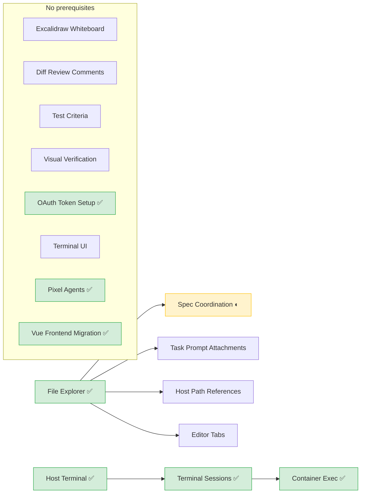

# Specs

Wallfacer roadmap, organized by track and connected by shared design foundations.

A spec that shipped or was retired lives under `specs/.archive/`, at the same
relative path, with `status: archived`. Its row stays in its track's table,
labeled **Complete** when it shipped and **Archived** when it was retired, and
the [Archive](#archive) section at the bottom lists the rest. One exception:
the console redesign tree stays in the active tree with `status: complete`,
because the frontend's tests and the screenshot suite cite and render it as the
design reference.

Statuses in this index mirror each spec's frontmatter. `Drafted` means designed
and unbuilt; it does not mean scheduled. `Stale` means the text is known to be
wrong against the code, and the spec says where.

## Status Quo

What has shipped vs what remains. ✅ = complete, ◐ = in progress, ○ = not started, ⊘ = archived.

```
Foundations - 7/7 complete (see Archive)

Pure-local - the 2026-10-19 cleanup (the active program)
  ◐ Pure-Local Wallfacer (decision record; container execution removal open)
  ⊘ removed: artifacts, routines, latere.ai sign-in and cloud mode, the
    coordination plane and spec comments, the hosted server, the sandbox
    proxy, the Topos harness

Spec Coordination - complete (its own track; spec tree, planning, dispatch)
  ✅ Document Model                ✅ Spec Archival
  ✅ Planning UX                   ✅ Chat-First Mode
  ✅ Planning Chat Threads         ✅ Spec State Control Plane

Local Product - shipped work in the Archive; five designs unbuilt
  ✅ Terminal Sessions             ✅ OAuth Token Setup
  ✅ Pixel Agent Avatars           ✅ Refinement Into Plan
  ✅ Vue Frontend Migration        ✅ Rebrand Module Path
  ✅ Backend Redundancy Cleanup    ✅ Editor Tabs
  ✅ Diff Review Comments          ✅ Excalidraw Whiteboard
  ✅ Map Mission Control           ✅ Mission Control
  ✅ Free-Form Specs               ✅ Archive Active Task Guard
  ✅ Unified Transcript Render     ✅ Agent Resource Governance
  ✅ Remove Idea-Agent Subsystem   ✅ Chat Model Transparency
  ✅ Dockable Terminal (splits closed)
  ✅ Test Criteria                 ✅ Visual Verification (in CI)
  ✅ Adversarial Review (now review on a second model)
  ✅ Workspace Model
  ⊘ removed: Desktop App, Container Exec, Routine Tasks, Static Artifacts,
    Agents & Flows and the agent graph, Topos runtime and live events,
    Live Serve (never built), First-Run Onboarding (stub)

  Designed, unbuilt, not scheduled
    ○ Task Prompt Attachments      ○ Scoped Command Registry
    ○ Host Path References         ○ Terminal UI (TUI mode)
    ○ Internal Consolidation

Shared Design - complete
  ✅ Agent Abstraction             ✅ Host Exec Mode
  ✅ Host as Only Backend          ✅ Harness Abstraction (5 CLI harnesses)
  ✅ Agent Session Vocabulary      ✅ Visual Identity Rebrand
  ✅ Selectable Color Themes       ✅ Spec Workflow Plugin
  ✅ Console Redesign (kept active as the design reference)
  ⊘ Token & Cost Optimization, Extensible Prompts, Overlay Snapshots,
    Platform-Native Wallfacer, Topos as the Only Harness

Git Workflow - local git
  ✅ Intent-Driven Commits         ○ Task Revert (unbuilt)
  ⊘ GitHub Integration and its children (retired 2026-10-02)

Archived tracks
  ⊘ Identity: sign-in, account and org isolation, collaboration
  ⊘ Cloud Platform: platform integration, coordination plane, hosted
    execution, hosted board
```

Where things stand after the 2026-10-19 cleanup. The maintainer made
wallfacer a pure local tool: a task board on one machine that drives the
coding-agent CLIs installed there, with no hosted service, sign-in,
coordination or remote execution. The decision, in the maintainer's words, and
what happens to stored data are in [pure-local](shared/pure-local.md).

Every active spec was checked against that decision. Specs for removed
features, superseded designs, stale specs, and designs with no path for a
local tool moved to the archive with a note saying why. What remains active is
the decision record, the console redesign tree, five designed and unbuilt
local specs, and task revert.

---

## Pure-Local

The active program: the 2026-10-19 cleanup that keeps wallfacer's current shape and removes everything that existed for the Latere platform or for features no longer wanted.

| Spec | Status | Delivers |
|------|--------|----------|
| [pure-local.md](shared/pure-local.md) | Validated | **Decision record.** The maintainer's words, each removal with what happens to stored data and settings (routine cards skipped at load, owner fields dropped on the next save, sign-in and coordination files left on disk unread, a task naming `topos` running on the default harness), what stays, and the open item: container execution. Supersedes [platform-native](.archive/shared/platform-native.md). |

---

## Spec Coordination

Recursive spec tree model, planning UX, dispatch workflow, and lifecycle automation. Promoted to its own track: it is the largest self-contained body of work in the project, and the whole tree is now archived under `specs/.archive/local/spec-coordination/`. All four subtrees are implemented, including the drift pipeline's agent-backed tester (gated behind `WALLFACER_DRIFT_TESTER`, off by default).

| Spec | Status | Delivers |
|------|--------|----------|
| [spec-coordination.md](.archive/local/spec-coordination/spec-coordination.md) | **Complete** | Umbrella: recursive spec tree model, dispatch workflow, cross-task context, lifecycle automation. All four subtrees shipped; two residual stale leaves (lossy planning resume, codex compat re-scope) tracked as follow-ups. |
| ↳ [spec-document-model.md](.archive/local/spec-coordination/spec-coordination/spec-document-model.md) | **Complete** | Spec frontmatter schema, filesystem-derived tree, `depends_on` DAG, six-state lifecycle (including `archived`), per-spec and cross-spec validation, recursive progress tracking, impact analysis. Extracted `internal/pkg/dag/`, `internal/pkg/tree/`, `internal/pkg/statemachine/` |
| ↳ [spec-archival.md](.archive/local/spec-coordination/spec-coordination/spec-archival.md) | **Complete** | Sixth lifecycle state (`archived`), hidden by default, read-only, excluded from impact / progress / drift / stale-propagation. Cascades over non-leaf subtrees on archive; unarchive reverses via `git revert`. Muted rendering in explorer and minimap; archived banner with stacked undo toasts. |
| ↳ [spec-planning-ux.md](.archive/local/spec-coordination/spec-coordination/spec-planning-ux.md) | **Complete** | Three-pane spec mode (explorer, focused markdown view, chat stream), planning sandbox, chat-driven spec iteration, dispatch & board integration, undo snapshots, planning cost tracking. |
| ↳↳ [chat-first-mode.md](.archive/local/spec-coordination/spec-coordination/spec-planning-ux/chat-first-mode.md) | **Complete** | Rename "Spec" to "Plan", collapse the layout when no specs exist, `/create` directive parser and bootstrap choreography. All 14 leaf tasks shipped. |
| ↳↳ [planning-chat-threads.md](.archive/local/spec-coordination/spec-coordination/spec-planning-ux/planning-chat-threads.md) | **Complete** | Multi-tab planning chat: independent conversation threads sharing the single planner, per-thread session/history/unread, inline rename, archive-only deletion, `git revert` thread-scoped undo, crash-safe migration. Shipped (ThreadManager, `/api/planning/threads`, PlanningChatPanel.vue). |
| ↳↳ [dedicated-chat-ui.md](.archive/local/spec-coordination/spec-coordination/spec-planning-ux/dedicated-chat-ui.md) | **Complete** | Chat promoted to a first-class Claude-style surface: sidebar leads with Chat/Plan/Board, a dedicated `/chat` view (`ChatPage.vue`) with a session sub-sidebar and entry screen (supersedes chat-first), and a floating draggable popup (`SpecChatPopup.vue`) in plan mode, now enabled. Frontend-only, reusing the thread model; one extracted chat core (`useChatSession`, `ChatMessageList`/`ChatComposer`/`SessionList`) mounted by both surfaces. |
| ↳↳ [session-persistence.md](.archive/local/spec-coordination/spec-coordination/spec-planning-ux/planning-chat-agent/session-persistence.md) | **Archived** | Faithful planning-conversation resume. Not built: the lossy `BuildHistoryContext` fallback is still the live behavior. Archived with the tree; a faithful resume would be specced again against the host-process chat agent. |
| ↳ [spec-state-control-plane.md](.archive/local/spec-coordination/spec-coordination/spec-state-control-plane.md) | **Complete** | Server-managed lifecycle transitions: 7th `testing` state with completion gate, two-channel stale propagation, chat-edit fan-out, dispatch → `validated` + folder dispatch, explicit-validate/mark-stale/dismiss/force-complete actions, advisory staleness scan, and the task-done drift pipeline (`validated → testing → complete`/`stale` with fan-out, `testing_pending` on tester failure, per-workspace commit mutex). Agent-backed drift tester (`runner.AssessDrift` + `drift.tmpl`) wired through `NewRunnerDriftTester`, gated behind `WALLFACER_DRIFT_TESTER` (off by default — the hook preserves complete-on-done unless the flag is set). |

---

## Local Product

Desktop experience and developer workflow improvements. No cloud dependency. Ships value to single-user deployments.

| Spec | Status | Delivers |
|------|--------|----------|
| [chat-model-transparency.md](.archive/local/chat-model-transparency.md) | **Complete** | The observed harness model in the chat window: a header badge on all three chat surfaces, a per-turn chip on a turn whose model differs from the session's, and task provenance that records the model that actually ran. `harness.Event.Model` (Claude only). |
| [task-prompt-attachments.md](local/task-prompt-attachments.md) | Drafted | Drag-and-drop file and image attachments for task prompts and feedback: per-task blobs, staged into the worktree under `.attachments/` and listed in the first-turn prompt for the agent's file-read tool. Harness-neutral. Unbuilt. |
| [inline-file-panel.md](.archive/local/inline-file-panel.md) | Complete | VS Code-style file tabs in the board top bar: `editorTabs` store, `EditorTabStrip`, CodeMirror 6 editor, preview tabs, board task-status indicators; replaces the `ExplorerPanel` preview modal. Multi-modal preview + raw-content endpoint deferred to Future. Supersedes the archived file-panel-viewer. |
| [inline-diff-feedback.md](.archive/local/inline-diff-feedback.md) | **Complete** | Code-review-style inline comments anchored to Changes-tab diff lines, batched into the existing feedback channel, with the inline surface login-gated server-side like spec comments. Implemented directly (not dispatched); also fixed the `submitFeedback` `feedback`/`message` key bug. |
| [map-mission-control.md](.archive/local/map-mission-control.md) | **Complete** | Rebuilt the orphaned read-only Map into an actionable mission-control surface: a server-side unified spec+task graph (`GET /api/graph` + pure `internal/graph` builder), a clean hand-rolled-SVG renderer (no new dep; RAF-batched drag, curved edges) replacing the ~4,583-line vendored depgraph, and inline node actions (dispatch a validated spec, start a ready task, jump to Board/Plan) with operational "ready to act" highlighting. |
| [mission-control.md](.archive/local/mission-control.md) | **Complete** | Evolve the Map into **Mission Control**: rename the surface (`/mission`, redirect `/map`), drive the full spec-coordination lifecycle from the graph (server transitions via widened `available_actions` from the state machine; generative ops by focusing the node's spec and mounting the existing `SpecChatPopup`), and visualize running tasks live (SSE-driven in-place node animation + "you are here" on the critical path). Design = reuse, not a new engine. |
| [workspace-model.md](.archive/local/workspace-model.md) | **Complete** | **Foundation redesign.** Decoupled a workspace's identity (stable UUID + `DataKey` storage handle) from its membership (a mutable folder set), owned by a personal user or org. Retired the "identity = hash of sorted paths" model (`InstructionsKey`→`WorkspaceDataKey`) that orphaned scoped data (`data/<key>/`) on any folder edit. `MigrateToWorkspaces` rewrites `workspace-groups.json`→`workspaces.json` moving zero bytes (live groups keep their existing data-dir hash) and adopts orphaned task history as dormant workspaces (dry-run-validated on real data: 9 live + 11 dormant + 6 empty skipped). Manager by-id CRUD + safe `UpdateFolders`; HTTP CRUD + activate-by-id; Vue store/picker/editor. Renamed `Group`→`Workspace` across Go/API/Vue. Cloud workspace objects, multi-repo association, folder sandboxing, and a live-instance round-trip deferred (see Outcome). |
| [dockable-panel-workspace.md](.archive/local/dockable-panel-workspace.md) | **Complete** | The terminal docks to any edge, maximizes, and is dragged by its header onto a drop zone, with the layout persisted (`DockWorkspace`, dock store, pure reducers). Splits, tab groups and the explorer as a dock panel were not built and are closed with the spec; their unwired reducers were removed. |
| [test-criteria.md](.archive/local/test-criteria.md) | **Complete** | User-defined free-form test criteria persisted on a task (`Task.Criteria`), settable in the composer, and fed to the manual test trigger, the auto-tester and review. Supersedes the archived validation-barrier. |
| [static-artifacts.md](.archive/local/static-artifacts.md) | **Archived** | Static serving of self-contained HTML artifacts from `<workspace>/artifacts/` with a gallery at `/artifacts`. Shipped, then removed on 2026-10-02 by [retire-artifacts](.archive/shared/platform-native/retire-artifacts.md). |
| [review-adversarial-verification.md](.archive/local/review-adversarial-verification.md) | **Complete** | Post-run adversarial multi-agent review: critics over all five harnesses, a session proposer on the fork-session path, and an auto-review step in the autoimplement loop behind a toggle (off by default). Shipped, then revised on 2026-06-26 after a review of v1 found runaway auto-runs; the revision in the spec is the design of record. |
| [visual-verification.md](.archive/local/visual-verification.md) | **Complete** | Browser-based UI regression checks (`frontend/scripts/ui-shots/checks.mjs`, `make ui-test`) that catch render crashes and broken layout with deterministic geometry assertions, not pixel-diffing. Runs in CI. |
| [unified-transcript-rendering.md](.archive/local/unified-transcript-rendering.md) | **Complete** | Activity tab gets a `Raw ↔ Rendered` transcript toggle (default Rendered) that works for all five harnesses. Hybrid normalization: Claude keeps the rich FE `prettyNdjson` parser; cursor/opencode/pi render from the backend canonical `harness.Event` via a new `?format=normalized` on the logs stream; codex's `item.*` gets enriched; additive `KindThinking`. Fixes the prose-only raw-JSON dump and renders the answer prose. Review gets only a raw toggle (no refactor). |
| [internal-consolidation.md](local/internal-consolidation.md) | Drafted | Behavior-preserving refactors surfaced by a codebase audit: a handler mutate-commit helper family, a runner `failTask` terminal-state helper, a shared one-shot LLM-call + NDJSON-parse path, one source of truth for the prompts template-name set, and workspace storage-identity out of the prompts package. Unbuilt; the audit's mechanical cleanups already landed. |
| [scoped-command-registry.md](local/scoped-command-registry.md) | Drafted | Promote the flat slash-command registry (`internal/agentsession/commands.go`, no scope field today, served at `GET /api/agent/commands`) to a surface-agnostic package with per-scope catalogs (planning, task_create, task_waiting) so the board composer gets its own `/` commands. Unbuilt. |
| [host-mounts.md](local/host-mounts.md) | Drafted | Per-task host path references surfaced to the agent in the first-turn prompt. Nothing is mounted or copied under host execution; read-only is advisory. Unbuilt. |
| [live-serve.md](.archive/local/live-serve.md) | **Archived** | Build and run developed software from within Wallfacer: serve sessions, build discovery, app secrets, a log panel. Never built; retired on 2026-10-02 because web apps are previewed through the platform's Apps capability. Apps hosts static sites only; a server process runs in the console's terminal. |
| [agent-resource-governance.md](.archive/local/agent-resource-governance.md) | **Complete** | Stop Test/Review from pegging the machine: host agents run in their own process group throttled to background priority (macOS `PRIO_DARWIN_BG`, Linux nice), a global `WALLFACER_MAX_AGENTS` budget (opt-in), review defaulted to its floor (1 fork / 3 rounds), and forks/rounds/cost-cap/nice/budget surfaced in the Execution settings tab via `/api/env`. OQ-3 (darwin child-backgrounding permission) pending empirical confirmation. |
| [terminal-ui.md](local/terminal-ui.md) | Drafted | Full TUI mode over the same HTTP API: interactive terminal board, log streaming, task lifecycle via Bubble Tea (`internal/tui/`). Unbuilt. |
| [archive-active-task-guard.md](.archive/local/archive-active-task-guard.md) | **Complete** | Spec archive guard blocks only when a dispatched task is still active; terminal (done/failed/cancelled) or stale links no longer 409. Fixes a complete tree refusing to archive. |
| [excalidraw-whiteboard.md](.archive/local/excalidraw-whiteboard.md) | **Complete** | Whiteboard drawing/brainstorm canvas as a peer Vue view, backed by a per-workspace scene file (`GET`/`PUT /api/whiteboard`). Excalidraw runs in a lazily-loaded React island; the app entry chunk stays React-free. |
| [free-form-specs.md](.archive/local/free-form-specs.md) | **Complete** | Render frontmatter-less markdown specs read-only in spec mode (previously they silently collapsed the tree to empty), plus a non-blocking, dismissible suggestion to migrate them into wallfacer lifecycle-managed specs via opt-in frontmatter scaffolding. Shipped: `ErrMissingFrontmatter` sentinel + `BuildTree` doc nodes, `InjectFrontmatter`, `migrate` transition action, explorer doc-node rendering + adopt banner. |
| [refinement-into-plan.md](.archive/local/refinement-into-plan.md) | **Complete** | Retired the bespoke refine pipeline. Plan mode edits task prompts directly via a Task Prompts explorer section and a task-aware `update_task_prompt` tool. Rounds persist as task events; undo is event rewind for task mode, git revert for spec mode. |
| [backend-redundancy-cleanup.md](.archive/local/backend-redundancy-cleanup.md) | **Complete** | Umbrella for follow-ups to the June 2026 pass-1 cleanup. All children landed or retired: the 6 API-surface leaves collapsed verb-specific routes into PATCH/parameterised endpoints (123 → 113 routes). `ideate` archived; `transitionTask` helper deferred. |
| [rebrand-module-path.md](.archive/local/rebrand-module-path.md) | **Complete** | Migrated the module path from `changkun.de/x/wallfacer` to `latere.ai/x/wallfacer` (267 files, `ffce4807`). Two follow-ups (wallfacerd image rename, vanityOwners override) deferred, gated on the repo moving into the `latere-ai` GitHub org. |
| [routine-tasks.md](.archive/local/routine-tasks.md) | **Archived** | Routines as board cards (`Kind=routine`) with a schedule that spawn fresh instance tasks when they fire. Ideation migrated to a `system:ideation`-tagged routine. Shipped, then removed on 2026-10-19; stored routine cards stay on disk unread. |
| [agents-and-flows.md](.archive/local/agents-and-flows.md) | **Complete** | Agent role + pipeline as first-class user primitives. Sidebar Agents and Flows tabs; the composer simplifies to "pick a Flow, write a prompt". Seeded built-in flows replace the old TaskKind + Agent-overrides surface. |
| [topos-runtime-integration.md](.archive/local/topos-runtime-integration.md) | **Archived** | Shipped, then removed on 2026-10-19 with the Topos harness ([pure-local](shared/pure-local.md)). The public `latere.ai/x/topos` runtime embedded as an in-process execution path (`agentic` flow kind) behind the `internal/agentgraph` seam and its import guard, with a real model through the gateway and the run's trace served and rendered. M1-M5 shipped; M6 (the unified surface) left for unified-agent-graph-ui. The pin predates the runtime's upstream rebuild; moving it is a migration of the seam. |
| [topos-live-agent-events.md](.archive/local/topos-live-agent-events.md) | **Archived** | Shipped, then removed on 2026-10-19 with the Topos harness ([pure-local](shared/pure-local.md)). Live agent events for topos runs. topos gained a root `Options.Observer` seam + `EventAssistantMessage` (per-turn text) + the entry session-id↔node-id join fix (topos `d8e51f8`); wallfacer's agentgraph seam forwards the run's events (assistant text, delegations, tool use) onto the task timeline via the existing `/api/tasks/stream` live path — the multi-agent transcript now appears as the run proceeds, no new endpoint or UI. Bespoke SSE + trace-node animation deferred as optional polish. Shipped: topos v0.0.5 tagged + pushed, go.mod bumped, verified building GOWORK=off. |
| [unified-agent-graph-ui.md](.archive/local/unified-agent-graph-ui.md) | **Complete** | One agent-graph page at `/agent-graph` (agent registry, fleet editor, run overlay) in place of the Agents and Flows pages, which were deleted. The pipeline gestures built along the way were dropped in the fleet rebuild. |
| [agent-graph-e2e-design.md](.archive/local/agent-graph-e2e-design.md) | **Archived** | Withdrawn 2026-10-02 with the decision to retire fleets. Its body is the accurate record of the four execution paths as they ran and of the two findings that motivated the removal (a fixed-sequence user fleet never commits; delegating fleets merge with no test step, no oversight and no stop in `waiting`). |
| [workflows-graph-ux.md](.archive/local/workflows-graph-ux.md) | **Archived** | Renamed Flows to Workflows and drew a read-only pipeline (2026-06-15). Retired when the agent-graph page replaced `FlowsPage` two weeks later, before its on-canvas editing was built. |
| [remove-idea-agent-subsystem.md](.archive/local/remove-idea-agent-subsystem.md) | **Complete** | Full teardown of the idea-agent (brainstorm) auto-ideation engine and the test-only flow: removed across runner/handler/flow/agents/store/envconfig/constants/apicontract/frontend/docs. Accepted feature loss; clears vestigial flow paths ahead of the agent-graph convergence. |
| [first-run-onboarding.md](.archive/local/first-run-onboarding.md) | **Archived** | Stub for a guided first run. Archived 2026-10-19: its agent-graph half lost its subject with the fleets, and the rest waited on sign-in and a harness migration that were dropped. |
| [agents-and-flows/refinements.md](.archive/local/agents-and-flows/refinements.md) | **Archived** | Post-ship follow-ups: split-pane UI redesign, token-based CSS restyle, `Role.PromptTmpl` runtime wiring, a dedicated `docs/guide/agent-graph.md` guide (removed with the fleets, 2026-10-02), and a cross-reference repair across 12 docs. |

Archived local specs (superseded or dropped) are listed in the [Archive](#local-archived-superseded-or-dropped) section below.

### Local product dependencies



---

## Shared Design

Cross-cutting design specs: the interfaces and behaviors the local product is built on.

| Spec | Status | Serves | Delivers |
|------|--------|--------|----------|
| [agent-abstraction.md](.archive/shared/agent-abstraction.md) | **Complete** | Both | `AgentRole` descriptor + `runAgent` primitive unify the seven sub-agent roles onto one launch path. Shipped Option A across 5 migration phases; Options C / D deferred. |
| [host-exec-mode.md](.archive/shared/host-exec-mode.md) | **Complete** | Local | `HostBackend` that execs host-installed `claude`/`codex` directly. No image pull, no container. Covers both agents, live NDJSON streaming, parallel-cap default, Settings UI warning, host-mode E2E harness. |
| [host-default.md](.archive/shared/host-default.md) | **Complete** | Local | Make host the only local backend: remove `LocalBackend`, the `--backend` flag, image pull plumbing, the Sandbox Images UI, and the agent `Dockerfile`. Cloud / Cella path unaffected. |
| [harness-abstraction.md](.archive/shared/harness-abstraction.md) | **Complete** | Both | `internal/harness/` with a `Harness` interface (BuildArgv / ParseEvent / AuthEnv / Capabilities). All five Tier-A harnesses (Claude, Codex, Cursor, OpenCode, Pi) **shipped** and selectable. Topos is a remote *executor*, not a harness. |
| ↳ [harness-abstraction/interface.md](.archive/shared/harness-abstraction/interface.md) | **Complete** | Both | Skeleton package: interface, value types, registry, fake harness for tests. |
| ↳ [harness-abstraction/claude-and-codex-migration.md](.archive/shared/harness-abstraction/claude-and-codex-migration.md) | **Complete** | Both | Move Claude / Codex argv + parse logic into `harness.Claude` / `harness.Codex`; delete `host_codex.go` and Codex's fake-Claude-result synthesis. |
| ↳ [harness-abstraction/cursor.md](.archive/shared/harness-abstraction/cursor.md) | **Complete** | Both | Cursor (`cursor-agent`) harness, first validation case. Shipped: `harness.Cursor` adapter, `launchCursor` host wiring (forces `--force --trust`), registry-driven `config.go` list, env/UI/doctor surfacing, docs, unit + build-tag-gated live e2e. Validation finding: registration needs the hardcoded `{claude,codex}` call sites generalized. |
| ↳ [harness-abstraction/opencode.md](.archive/shared/harness-abstraction/opencode.md) | **Complete** | Both | OpenCode (`opencode run`) harness, provider auth managed by the harness itself. Shipped: harness adapter, host-mode launcher (synthesizes the terminal result opencode omits), config/env wiring, docs, gated live e2e. |
| ↳ [harness-abstraction/pi.md](.archive/shared/harness-abstraction/pi.md) | **Complete** | Both | Pi (earendil-works coding agent) harness, JSON mode. Shipped: `harness.Pi` adapter, `launchPi` host wiring, config/UI surfacing, docs, unit + build-tag-gated e2e tests. |
| [token-cost-optimization.md](.archive/shared/token-cost-optimization.md) | **Archived** | Both | Cache observability, `--resume` correctness audit, host-side shell output compression, regression model, budgeting. Archived: baseline cost-visibility tiles shipped; the rest is premised on caching wallfacer doesn't control or is speculative polish. Sat drafted from April with 0/14 criteria built. |
| [extensible-prompts.md](.archive/shared/extensible-prompts.md) | **Archived** | Both | Discoverable, user-creatable prompt system replacing hardcoded `internal/prompts` templates with skill-like files discovered at runtime. Archived: superseded by the Topos agent-document model (the discoverable/composable unit is now the `topos.latere.ai/v1` agent document, with the `harness/skills` layer for capabilities); what remains in `internal/prompts/` is internal harness plumbing that benefits from staying typed and compiled. Was its prompt-provider for the archived `agent-abstraction`. |
| [agent-session-vocabulary.md](.archive/shared/agent-session-vocabulary.md) | **Complete** | Both | Generalized the "planning" chat machinery (`internal/planner/` -> `internal/agentsession/`, `PlanningThread` -> `AgentSession`, `usePlanningStore` -> `useAgentStore`, `/api/planning/*` -> `/api/agent/*`) onto one `AgentSession` vocabulary. Kept genuine spec-plan code ("Plan" tab, `commitPlanningRound`) and frozen `Plan-Round:` git trailers named "plan". Migrated routes, storage, env, and localStorage with a one-time shim. |
| [overlay-snapshots.md](.archive/shared/overlay-snapshots.md) | **Archived** | Both | Overlay snapshot + CRIU checkpoint/restore for warm container startup. Archived: the per-task container model it optimized was removed in favor of host execution. No replacement. |
| [visual-identity.md](.archive/shared/visual-identity.md) | **Complete** | Both | Umbrella: replace the Anthropic/Claude-like identity (cream `#f4f1ea`, terracotta `#c45a33`/`#d97757`, Instrument Serif) with an indigo-on-zinc system, rebuild the marketing site with animation/interactive graphics, and tear down + rewrite the drifted docs. Token names stay stable; three children below. |
| ↳ [visual-identity/design-tokens.md](.archive/shared/visual-identity/design-tokens.md) | **Complete** | Both | New palette + all-sans/mono type system in `tokens.css` (values only, names stable), base.css token-block reconciliation, Space Grotesk + bundled JetBrains Mono, in-repo `.wallfacer-brand` override, retheme of the four `data-theme`-observing components, full ui-shots light+dark sweep. |
| ↳ [visual-identity/marketing-site.md](.archive/shared/visual-identity/marketing-site.md) | **Archived** | Cloud | Shipped, then removed on 2026-10-19 with the product and install pages ([pure-local](shared/pure-local.md)). Animated marketing site: SVG hero simulation (self-playing board/agent-graph), scroll reveals (`useScrollReveal`), glow/aura helpers, interactive capability demos, animated stats. Hand-rolled, SSG-safe, reduced-motion gated. Depends on design-tokens. |
| ↳ [visual-identity/theme-system.md](.archive/shared/visual-identity/theme-system.md) | **Complete** | Both | Slack-style user-selectable color themes: clay (the original palette) restored as default, indigo/amber/rose/copper as presets in palettes.css via a data-palette axis, typed PaletteName roster in the prefs store, Settings > Appearance picker, Lato as the UI sans. |
| ↳ [visual-identity/docs-rewrite.md](.archive/shared/visual-identity/docs-rewrite.md) | **Complete** | Both | Docs teardown + re-architecture from the shipped surface: new 13-guide IA (agent-graph, mission control, whiteboard, GitHub, device sign-in documented; brainstorm/ideation/Agents+Flows drift removed), internals refresh + 2 new files, single-source nav (generator emits `data/docs.ts` from `usage.md` reading order), CLI usage fix, theme-refreshed screenshots. |
| [spec-workflow-plugin.md](.archive/shared/spec-workflow-plugin.md) | **Complete** | Both | Published the `wf-spec-*` lifecycle skills as the `spec` plugin in the public `latere-ai/claude-plugins` marketplace, installable into any repo. All 14 skills are unprefixed and namespaced (`/spec:create`), with `diff` renamed `drift` and `status` renamed `report` to clear name collisions. Wallfacer mirrors them into `.claude/skills/` for harness reach (`claude -p` does not install plugins, verified) behind a bidirectional `make skills-pull`/`skills-push`/`skills-check` gate; the three server-coupled skills invert to file-first with the transition API as an optional accelerator. |
| [console-redesign.md](.archive/shared/console-redesign.md) | **Complete** | Both | Umbrella: rebuild the signed-in console on the replichai visual system. Palette P2 (clay accent on a neutral canvas; cream demoted to a `paper` preset), matte material (`latere-ui/glass` dropped, no `backdrop-filter`), rail on the deep ground with the content as an inset 20px card, one topbar replacing the status bar, pill controls and a five-state semantic ramp. Token names stay stable. Eleven children below, one per surface, each gated by a `checks.mjs` scene and light+dark screenshots. |
| ↳ [console-redesign/tokens-and-primitives.md](.archive/shared/console-redesign/tokens-and-primitives.md) | **Complete** | Both | P2 values in `tokens.css`, `paper` preset, derived tint pairs, type and radii ladders, matte shadows, glass tokens pinned opaque, `primitives.css` (`.btn .icon-btn .pill .card .rows .row .seg .field .eyebrow`) with aliases for the old `.badge-*`/`.btn-*` classes, `designSystem.test.ts` guards. |
| ↳ [console-redesign/shell.md](.archive/shared/console-redesign/shell.md) | **Complete** | Both | Own `AppRail` (replaces latere-ui `ConsoleSidebar`), `WorkspaceChip` (switcher + connection dot + branch actions), inset `.app-main` card, 52px `Topbar` with a per-page crumb and actions slot; `StatusBar` and `content-header.css` deleted. |
| ↳ [console-redesign/board.md](.archive/shared/console-redesign/board.md) | **Complete** | Both | Eyebrow column headers, 14px cards with a two-pill badge budget and a mono meta line for tags, primary/ghost card actions, composer as a card, search as a field; `--tag-bg-N` slots deleted. |
| ↳ [console-redesign/task-detail.md](.archive/shared/console-redesign/task-detail.md) | **Complete** | Both | `TaskDetail` as a sheet (header row, underline tabs, main column, 340px aside of cards with rows), `modal.css` id selectors replaced, `diffs.css`/`syntax.css`/`AgentTrace` on the ramp, one primary button instead of three action tiles. |
| ↳ [console-redesign/chat.md](.archive/shared/console-redesign/chat.md) | **Complete** | Both | One message list, composer card, session rows and popup shared by `/chat`, Plan and the floating popup; tool calls read like agent-trace rows. |
| ↳ [console-redesign/plan.md](.archive/shared/console-redesign/plan.md) | **Complete** | Both | Spec tree on nav-row geometry with ramp status dots, focused view as a 76ch reading column with a frontmatter card and lifecycle buttons, comments layer on cards; 1,300 scoped lines rebuilt. |
| ↳ [console-redesign/settings.md](.archive/shared/console-redesign/settings.md) | **Complete** | Both | Underline tabs and one card per section with label/help/control rows; Appearance picks mode and the six-palette roster including `paper`; `settings-modal.css` and `forms.css` deleted. |
| ↳ [console-redesign/agent-graph.md](.archive/shared/console-redesign/agent-graph.md) | **Archived** | Both | Shipped as part of the console redesign, then retired 2026-10-02 with the page it restyled, when fleets were removed. |
| ↳ [console-redesign/panels-and-overlays.md](.archive/shared/console-redesign/panels-and-overlays.md) | **Complete** | Both | Three shapes (`.pop`, `.dialog`, docked panel) for the command palette, workspace picker/editor, confirm, toasts, shortcuts, device sign-in, trash, dock, terminal, explorer, editor tabs and file editor; blur-free scrims. |
| ↳ [console-redesign/secondary-screens.md](.archive/shared/console-redesign/secondary-screens.md) | **Complete** | Both | Analytics boundary cards and a `chartPalette()` helper, routine rows, Mission Control canvas on the ramp (48 hex literals to zero), whiteboard frame, artifact grid, local docs on the shared prose column. |
| ↳ [console-redesign/verification-and-docs.md](.archive/shared/console-redesign/verification-and-docs.md) | **Complete** | Both | Delete the alias block, `make ui-test` in CI, seed and snapshot every surface light+dark via `regen.sh`, regenerate guide and README images, configuration guide roster and status-bar references updated. |

### Why these are shared

**Agent abstraction** refactors `internal/runner/`, the execution engine every surface uses. **Harness abstraction** adds coding agents (Cursor, OpenCode, Pi, and beyond) behind one interface instead of branching on agent type throughout the runner.

---

## Git Workflow

Git workflow on tasks. It is local git: every surface (tasks, planning rounds, spec transitions, explorer edits) commits with trailers and undoes via `git revert`, and pushing a branch uses the user's own git credentials. The GitHub half of this track (a token borrowed from the signed-in account, a pull request per task) was retired on 2026-10-02; its specs are archived and its code is removed by [remove-github-integration](.archive/shared/platform-native/remove-github-integration.md).

| Spec | Status | Delivers |
|------|--------|----------|
| [github-integration.md](.archive/intent/github-integration.md) | **Archived** | Retired 2026-10-02: wallfacer no longer connects to GitHub. Umbrella for GitHub as metadata on a task (a token borrowed from the signed-in account, a pull request per task). |
| ↳ [oauth-token-store.md](.archive/intent/github-integration/oauth-token-store.md) | **Archived** | Shipped, then retired with the whole integration on 2026-10-02. The brokered GitHub token: fetched through the identity service, cached per principal, shown in a Settings tab. |
| ↳ [repo-selection.md](.archive/intent/github-integration/repo-selection.md) | **Archived** | Retired: the repository list and picker were built and removed one day later. A pull request's repository is derived from the task's git origin. |
| ↳ [read-surface.md](.archive/intent/github-integration/read-surface.md) | **Archived** | Retired: PR and issue lists and detail were built and removed. What remains is one open-PR lookup per task and the shared API transport; issues have no replacement. |
| ↳ [pull-request.md](.archive/intent/github-integration/pull-request.md) | **Archived** | Retired 2026-10-02. Create, state and comment on a task's pull request had shipped; pushing the task branch, a generated title and body, and merged and closed states had not. |
| ↳ [cloud-remote-fix.md](.archive/intent/github-integration/cloud-remote-fix.md) | **Archived** | Retired 2026-10-02. Running an agent on a repository outside the platform's git host waits for a platform connector. |
| [task-revert.md](intent/task-revert.md) | Drafted | Not built. One-action revert of a done task's whole merged range (`BaseCommitHashes..CommitHashes`) per repository, in a temporary worktree fast-forwarded into the default branch, with an agent for conflicts, plus retry, cancel, events and usage. |
| [intent-commits.md](.archive/intent/intent-commits.md) | Complete | Task, planning, and explorer paths all auto-commit with attribution trailers and undo via `git revert`. |


Task revert is unbuilt and independent. Intent-commits is fully realized.

---

## Ordering Rationale

- The pure-local cleanup is the active program ([pure-local](shared/pure-local.md)). Its open item is the removal of container execution.
- Spec coordination is complete (document model, planning UX, archival, chat-first mode, planning threads, and the state control plane / drift detection all shipped; the drift pipeline's agent-backed tester is wired but gated behind `WALLFACER_DRIFT_TESTER`, off by default).
- Four feature specs (task-prompt-attachments, scoped-command-registry, host-mounts, terminal-ui), one refactor spec (internal-consolidation) and task revert are designed and unbuilt. None is scheduled; each is dispatchable after validation. Internal consolidation fits the cleanup best: it removes duplicated logic instead of adding surface.
- The console redesign tree stays active with `status: complete` as the design reference the frontend's tests and the screenshot suite cite.

---

## Archive

System of record for completed work. Stable, not under active development. Included for reference and dependency context only.

### Foundations

Abstraction interfaces that all tracks build on. All seven are shipped and stable.

| Spec | Delivers |
|------|----------|
| [sandbox-backends.md](.archive/foundations/sandbox-backends.md) | `sandbox.Backend` / `sandbox.Handle` + `LocalBackend` (since superseded by host-only `internal/executor`) |
| [storage-backends.md](.archive/foundations/storage-backends.md) | `StorageBackend` + `FilesystemBackend`; cloud backends (PG, S3) deferred to cloud track |
| [multi-workspace-groups.md](.archive/foundations/multi-workspace-groups.md) | Multi-store manager, runtime workspace switching |
| [container-reuse.md](.archive/foundations/container-reuse.md) | Per-task worker containers via `podman exec` (since superseded by host execution) |
| [file-explorer.md](.archive/foundations/file-explorer.md) | Browse + edit workspace files in the web UI |
| [host-terminal.md](.archive/foundations/host-terminal.md) | Interactive shell in the web UI (WebSocket + PTY) |
| [windows-support.md](.archive/foundations/windows-support.md) | Tier 2 Windows host support |

### Platform-native: superseded

The six decisions of 2026-10-02, superseded on 2026-10-19 by [pure-local](shared/pure-local.md). The fleet, GitHub, artifacts and live-serve decisions shipped and stay; the Topos-only harness is reversed.

| Spec | Status | Delivers |
|------|--------|----------|
| [platform-native.md](.archive/shared/platform-native.md) | **Archived** | Umbrella for the six decisions, in the maintainer's words. |
| ↳ [retire-agent-fleets.md](.archive/shared/platform-native/retire-agent-fleets.md) | **Complete** | Removed 2026-10-02: the agent-graph page, the flow engine, delegating fleets, user-authored roles, and the `/api/flows` and `/api/agents` APIs. Every task runs the built-in pipeline. |
| ↳ [remove-github-integration.md](.archive/shared/platform-native/remove-github-integration.md) | **Complete** | Removed 2026-10-02: the token broker and its cache, the pull-request surface on tasks, the Settings tab, eight routes and `internal/github`. Plain git push is untouched. |
| ↳ [retire-artifacts.md](.archive/shared/platform-native/retire-artifacts.md) | **Complete** | Removed 2026-10-02: the artifacts gallery and its routes. Files under `<workspace>/artifacts/` stay untouched. |
| ↳ [sessions-that-spawn-and-fork.md](.archive/shared/platform-native/sessions-that-spawn-and-fork.md) | **Archived** | Vague direction for agents that spawn and fork on a hosted board; neither the hosted board nor the Topos runtime exists. |
| [topos-native-harness.md](.archive/shared/topos-native-harness.md) | **Archived** | Topos as the only harness. Reversed: the in-process harness and the `latere.ai/x/topos` dependency were removed; phase 1a, review on a second model, shipped and stays. |

### Identity: archived

Sign-in, account and org isolation, and collaboration. All of it was removed on 2026-10-19 ([pure-local](shared/pure-local.md)); the per-machine server key is the board's one credential.

| Spec | Why archived |
|------|--------------|
| [authentication.md](.archive/identity/authentication.md) | Shipped OAuth2/OIDC sign-in, sessions and the request principal; removed 2026-10-19. |
| [auth-by-default.md](.archive/identity/auth-by-default.md) | Shipped zero-config browser sign-in, device-code login and the latere-ui console shell; removed 2026-10-19. |
| [local-account-isolation.md](.archive/identity/local-account-isolation.md) | Shipped per-account and per-org scoping of workspaces and tasks; removed 2026-10-19. |
| [local-device-signin.md](.archive/identity/local-device-signin.md) | Shipped the in-console device-code sign-in; removed 2026-10-19. |
| [multi-user-collaboration.md](.archive/identity/multi-user-collaboration.md) | Stale umbrella for a shared org board. Not pursued; the actor fields and org scoping it shipped were removed 2026-10-19. |
| ↳ [rbac-matrix.md](.archive/identity/multi-user-collaboration/rbac-matrix.md) | Archived 2026-10-02: identities carry no scopes. |
| [remote-control.md](.archive/identity/remote-control.md) | Controlling an instance from another machine through a coordinator; not pursued. |
| [third-party-oidc.md](.archive/identity/third-party-oidc.md) | Pluggable identity providers; wallfacer has no sign-in left to extend. |
| [agent-token-exchange.md](.archive/identity/agent-token-exchange.md) | Archived 2026-09-13: auth removed agent delegation. |

### Local: completed

| Spec | Delivers |
|------|----------|
| [provider-secret-store.md](.archive/local/provider-secret-store.md) | Provider credentials in the system keyring, explicit migration, safe temporary tests, and launch-time resolution without plaintext fallback. |
| [task-commit-history.md](.archive/local/task-commit-history.md) | Durable commit metadata and patches across feedback turns, retries, native execution, and worktree cleanup, with a live Changes list. |
| [desktop-app.md](.archive/local/desktop-app.md) | Wails native wrapper, archived, code removed 2026-06-14 |
| [terminal-sessions.md](.archive/local/terminal-sessions.md) | Multiple concurrent terminal sessions with tab bar |
| [terminal-container-exec.md](.archive/local/terminal-container-exec.md) | Attach to running task containers from the terminal panel |
| [oauth-token-setup.md](.archive/local/oauth-token-setup.md) | Browser-based OAuth sign-in for Claude and Codex credentials |
| [pixel-agents.md](.archive/local/pixel-agents.md) | Pixel art office view, animated characters representing task agents |
| [vue-frontend-migration.md](.archive/local/vue-frontend-migration.md) | Converged the vanilla-JS `ui/` board and the Vue `frontend/` site into one Vue 3 + TypeScript SPA; legacy `ui/` and its build/CI pipeline removed, single embedded `frontend/dist` served by the Go server. Superseded typescript-migration and typed-dom-hooks. |

### Local: archived (superseded or dropped)

Specs that were never implemented and whose designs target architecture since removed (the vanilla-JS `ui/` frontend, the per-task container model, the Goal field). The still-wanted features were re-specced against the current Vue + host-backend architecture; the dropped one has no replacement.

| Spec | Why archived |
|------|--------------|
| [file-attachments.md](.archive/local/file-attachments.md) | Built on `ui/js/tasks.js` and container `-v` mounts (both removed). Replaced by [task-prompt-attachments.md](local/task-prompt-attachments.md). |
| [file-panel-viewer.md](.archive/local/file-panel-viewer.md) | Built on `ui/js/explorer.js` (removed). Replaced by [inline-file-panel.md](.archive/local/inline-file-panel.md). |
| [diff-review-comments.md](.archive/local/diff-review-comments.md) | Vue-targeted redraft of the diff-comment feature. Folded back into the revived [inline-diff-feedback.md](.archive/local/inline-diff-feedback.md), which adds login-gating and owns the key-bug fix. |
| [spatial-canvas.md](.archive/local/spatial-canvas.md) | Exploratory infinite-canvas view targeting `ui/js/` (removed). No replacement specced. |

### Cloud: archived

The cloud track: the Latere platform integration, the coordination plane, hosted execution and the hosted board. Wallfacer became a pure local tool on 2026-10-19 ([pure-local](shared/pure-local.md)); nothing here is pursued, and what shipped was removed. The older rows record infrastructure the platform took over.

| Spec | Why archived |
|------|--------------|
| [latere-integration.md](.archive/cloud/latere-integration.md) | Umbrella for wallfacer as an application on the Latere platform. Sign-in, cloud mode, the coordination plane and the sandbox proxy that shipped under it were removed 2026-10-19. |
| ↳ [coordination-plane.md](.archive/cloud/latere-integration/coordination-plane.md) | The coordinator role, the outbound connector, spec comments and the Postgres comment store were removed 2026-10-19. |
| ↳↳ [repo-identity.md](.archive/cloud/latere-integration/coordination-plane/repo-identity.md) | Repository identity across instances; not pursued. |
| ↳↳ [connection-and-presence.md](.archive/cloud/latere-integration/coordination-plane/connection-and-presence.md) | The connection and registry that shipped were removed; presence across machines is not pursued. |
| ↳↳↳ [connection.md](.archive/cloud/latere-integration/coordination-plane/connection-and-presence/connection.md) | The connector, its opt-in gate and the registry were removed 2026-10-19. |
| ↳↳↳ [presence.md](.archive/cloud/latere-integration/coordination-plane/connection-and-presence/presence.md) | Org-wide presence; not pursued. |
| ↳↳ [metadata-projection.md](.archive/cloud/latere-integration/coordination-plane/metadata-projection.md) | A metadata projection to a coordinator; not pursued. |
| ↳↳ [spec-comments.md](.archive/cloud/latere-integration/coordination-plane/spec-comments.md) | Shipped inline spec comments; removed 2026-10-19. |
| ↳↳ [postgres-store.md](.archive/cloud/latere-integration/coordination-plane/postgres-store.md) | Shipped the Postgres comment store; removed 2026-10-19. |
| ↳ [topos-remote-executor.md](.archive/cloud/latere-integration/topos-remote-executor.md) | Hosted execution as a platform agent session; never built, not pursued. |
| ↳ [cella-runtime.md](.archive/cloud/latere-integration/cella-runtime.md) | Archived 2026-10-02: a sandbox backend at a standalone sandbox host. |
| ↳ [shared-cella-client.md](.archive/cloud/latere-integration/shared-cella-client.md) | Archived 2026-10-02: no wallfacer caller remained. |
| [cloud-infrastructure.md](.archive/cloud/cloud-infrastructure.md) | Hosted board deployment; not pursued. The wallfacerd deployment it extended was removed 2026-10-19. |
| [data-boundary-enforcement.md](.archive/cloud/data-boundary-enforcement.md) | What may leave the machine; the browser telemetry and coordination channels it governed were removed. |
| [claude-managed-agents.md](.archive/cloud/claude-managed-agents.md) | Retired 2026-10-02 as outdated: dispatching a task to Anthropic's Managed Agents API. |
| [antigravity.md](.archive/cloud/antigravity.md) | Retired 2026-10-02 as outdated: dispatching a task to Google's Antigravity Interactions API. |
| [multi-tenant.md](.archive/cloud/multi-tenant.md) | Control plane, per-user instance provisioning, routing, and hibernation were the Latere platform's; wallfacer builds none of it. |
| [billing-idempotency.md](.archive/cloud/billing-idempotency.md) | Charge mechanics belong to the platform's billing; wallfacer has no billing surface and shows cost as a figure on a task. |
| [tenant-filesystem.md](.archive/cloud/tenant-filesystem.md) | Archived 2026-10-02: worktree staging through a file plane that was withdrawn. |
| [tenant-api.md](.archive/cloud/tenant-api.md) | Archived 2026-10-02: a versioned external API with a wallfacer-issued key per tenant. |
| [local-build-deploy.md](.archive/cloud/local-build-deploy.md) | Local `make release` / `make deploy` for the wallfacerd server image. Implemented then reverted in favor of GitHub Actions (`0ba7b225`). |
